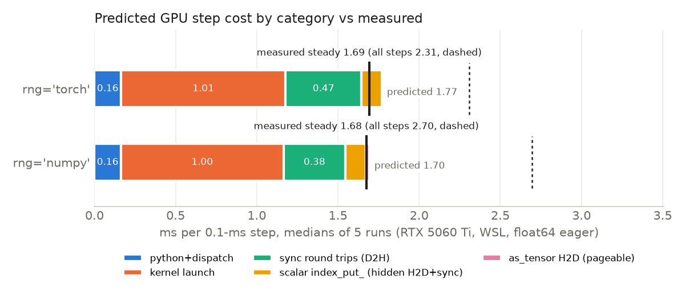
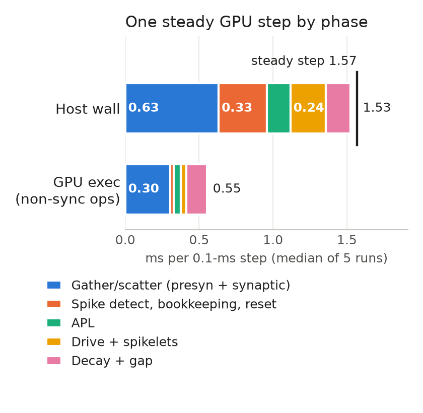
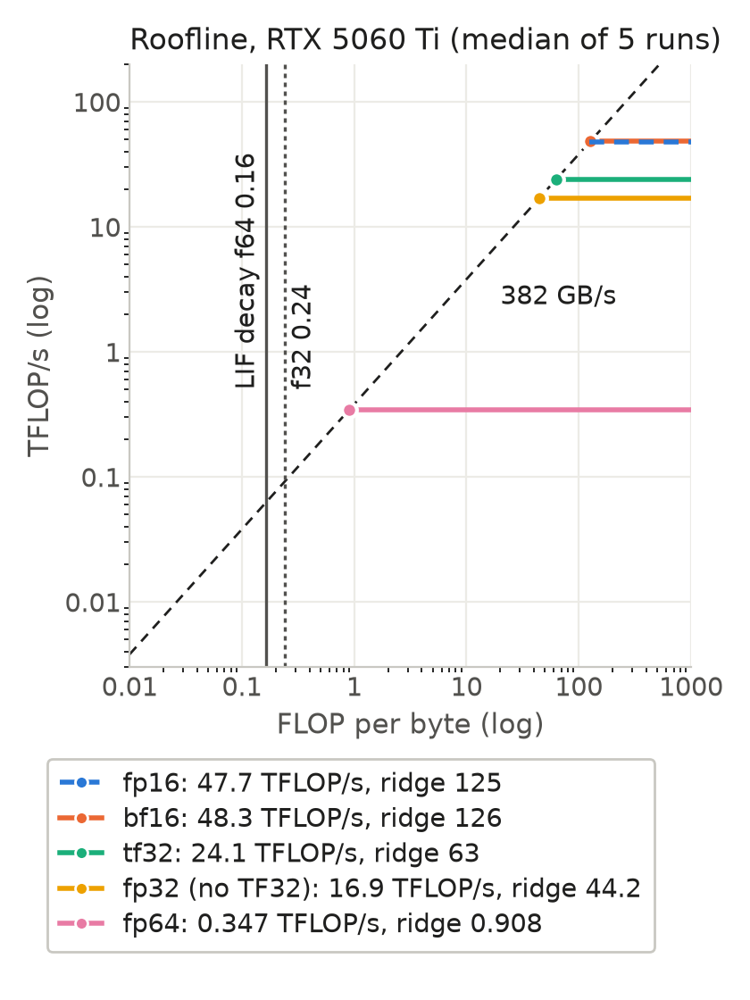
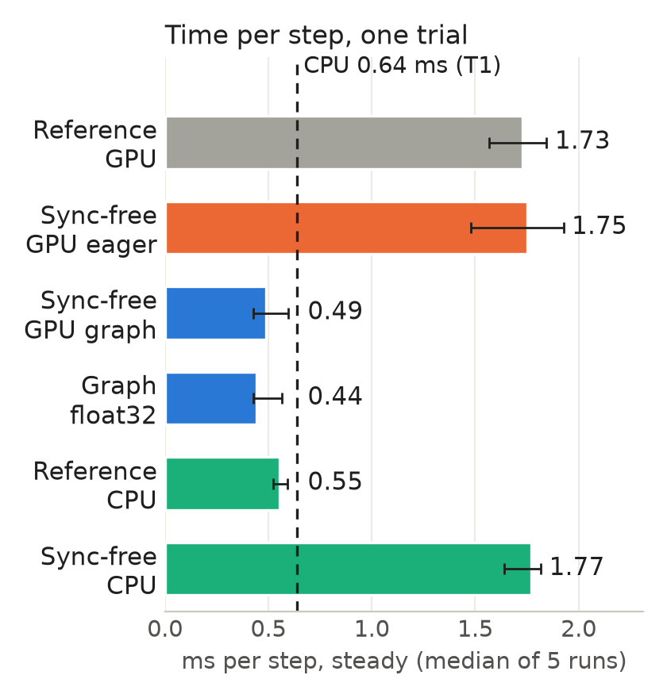

# Week 4 perf write-up: what one simulator step costs, and why

Brief: [progress/week4/tasks/T6_brief.md](../progress/week4/tasks/T6_brief.md). Daily log:
[progress/week4/perf_log.md](../progress/week4/perf_log.md). This page adds no new measurement: every number
below is copied from the file named next to it (all paths are in this repo). The only new outputs are the
re-drawn roofline PNG (same data, plain tick labels) and the device table, which
`bench/w4_summary_table.py` formats from the result JSONs.

## Summary in five lines

1. The simulator advances the fly's brain (165,122 neurons) in steps of 0.1 ms of biological time; on the
   RTX 5060 Ti the original step took 1.73 ms of wall time, three times the 0.55 ms of the 6-thread CPU.
2. The GPU was not slow at arithmetic: each step launched ~106 tiny kernels and stopped 10 times to wait for
   a result, and those waits and launches account for the whole step.
3. A new sync-free step (no waits, fixed-size arrays) was no faster on its own (1.75 ms), but it can be
   recorded once as a CUDA graph and replayed: 0.49 ms per step, slightly faster than the CPU.
4. The roofline shows why 64-bit floats are fine here: the decay step does 0.16 operations per byte, far
   below where even the slow 64-bit arithmetic (0.347 TFLOP/s) would be the limit.
5. Week 5: run many trials in one graph (target 8 trials at under 1 ms per step), fuse kernels (target
   0.25 ms per step for one trial), and judge Charlie's decay kernels against the 382 GB/s memory line.

Sources: line 1: [week04_day6.md](week04_day6.md) Results table
(`results/w4/DESKTOP-4C13T5V_20261122-1053_graph.json`); line 2: [week04_day3.md](week04_day3.md) Budget;
line 3: week04_day6.md Results; line 4: [week04_day5.md](week04_day5.md) Peak table and LIF decay section;
line 5: week04_day6.md Conclusions 2-3 and week04_day5.md Conclusions 1.

## Device table

One step = 0.1 ms of biological time, so bio-seconds per wall-second = 0.1 / (ms per step)
([week04_day3.md](week04_day3.md): "ms per 0.1-ms step"). Steady = mean of the steps <= 5 ms; all steps =
wall time / steps, stall steps included. Day 6 rows: one looming trial per run, 2,000 steps after 1,000
warm-up steps, 5 runs, median [min-max] across runs, float64 unless marked
([week04_day6.md](week04_day6.md), Setup). Generated by `python bench/w4_summary_table.py`
(also writes `results/w4/week04_device_table.{md,html}`; the site embeds the HTML verbatim).

| device and mode | dtype | steady ms/step | all steps ms/step | bio-s per wall-s | source |
|---|---|---|---|---|---|
| PC CPU (6 threads), reference | f64 | 0.55 [0.52-0.59] | 0.55 [0.52-0.59] | 0.181 [0.169-0.191] | Day 6, `perf/results/w4/DESKTOP-4C13T5V_20261122-1053_graph.json` |
| 5060 Ti, reference eager | f64 | 1.73 [1.57-1.85] | 1.79 [1.74-1.98] | 0.058 [0.054-0.064] | Day 6, `perf/results/w4/DESKTOP-4C13T5V_20261122-1053_graph.json` |
| 5060 Ti, reference eager + torch.compile | f64 | - | 2.07 (worst 2.17) | 0.048 (all steps) | Day 2, `perf/results/w4/DESKTOP-4C13T5V_20261116-2309.json` |
| 5060 Ti, sync-free eager | f64 | 1.75 [1.48-1.93] | 1.84 [1.27-1.93] | 0.057 [0.052-0.068] | Day 6, `perf/results/w4/DESKTOP-4C13T5V_20261122-1053_graph.json` |
| 5060 Ti, sync-free CUDA graph | f64 | 0.49 [0.43-0.60] | 0.45 [0.42-0.63] | 0.205 [0.168-0.234] | Day 6, `perf/results/w4/DESKTOP-4C13T5V_20261122-1053_graph.json` |
| 5060 Ti, sync-free CUDA graph | f32 | 0.44 [0.43-0.56] | 0.44 [0.43-0.45] | 0.225 [0.177-0.235] | Day 6, `perf/results/w4/DESKTOP-4C13T5V_20261122-1053_graph.json` |
| Mac CPU | - | not run | not run | not run | not measured in Week 4 |
| Mac MPS | - | not run | not run | not run | not measured in Week 4 |

How to read it:

- **Other measurements of the same rows agree within their ranges.** PC CPU: 0.60 [0.55-0.65] (rng='torch')
  and 0.62 [0.59-0.65] (rng='numpy') steady in Day 3 ([week04_day3.md](week04_day3.md), Per-step counts).
  Reference GPU: 1.69 [1.60-1.78] steady in Day 3 and 1.609 [1.552-1.864] in Day 4
  ([week04_day4.md](week04_day4.md), step table). Day 6 compares the graph with "CPU 0.64 ms (T1)"; Day 3's
  CPU medians are 0.60 / 0.62, and 0.64 is inside their ranges.
- **The torch.compile row is a different kind of number.** It comes from the Day 2 bench (`bench/w4_bench.py`,
  which is only on the PC, not in git): 0.2 bio-s from t = 0 with setup and warm-up included, median of 3
  repeats, worst repeat in brackets (`args.repeats = 3` in the JSON). It has no steady value and no min. The
  same file gives the eager reference 3.33 ms per step by that method (worst 3.98), so `compile=True`, which
  compiles only `_decay` ([week04_day4.md](week04_day4.md), Conclusions), cut that number to 2.07. In a 1-bio-s
  run of the same day it was 2.80 against 3.27 eager, and in float32 it did not help (3.31 vs 3.23 at 0.2 s;
  3.69 vs 3.67 at 1 s) (`results/w4/DESKTOP-4C13T5V_20261116-2309.json`, `..._20261116-2311.json`). Day 3
  explains why the Day 2 eager 3.3 ms is not the step cost: it holds setup, warm-up and ~11 ms WSL stalls
  ([week04_day3.md](week04_day3.md), "main vs the 3.3 ms").
- **Mac rows: not run.** Week 4 had no Mac session. The command to fill the MPS row is in
  [progress/week4/day1_results.md](../progress/week4/day1_results.md) (Speed).

## Day 2: copy bandwidth (now in git)

`results/w4/DESKTOP-4C13T5V_20261116-2308.{json,md}` (copied unchanged from the PC's
`~/flybench/flybrain/results/w4/bench/`): torch copy of 512 MB on the GPU, 382.0 GB/s median (p90 374.1);
Triton copy 376.0 GB/s; CPU copy 16.8 GB/s. This 382 GB/s is the slanted line of the roofline. Day 5
re-measured the same copy at 385.9 [385.7-386.1] GB/s ([week04_day5.md](week04_day5.md), Copy bandwidth),
and the next Day 2 run (2309) read 379.0 (`..._20261116-2309.json`). The 2309 and 2311
JSON/MD files are committed too, for the torch.compile row; their profiler traces (26 MB and 24 MB) are not.

## Day 3: overhead budget (where the 1.7 ms went)

[week04_day3.md](week04_day3.md). Timing the building blocks one by one and adding them up per step predicts
1.70 ms (rng='numpy') and 1.77 ms (rng='torch') against a measured steady 1.68 / 1.69 ms. Kernel launches
cost ~1.0 ms (about 60% of the predicted step) and the 10 waits for the GPU 0.38-0.47 ms plus 0.13 ms for
four scalar assignments; Python dispatch is only 0.16 ms, so a C++ rewrite would not help.

## Day 4: step anatomy (which part of the step)

[week04_day4.md](week04_day4.md). The synaptic work (presyn + synaptic gather/scatter) takes 0.63 ms of the
1.52 ms sum of phases and 54 of the 105 GPU ops, and holds most of the real GPU work (0.30 ms). The spike
phase (threshold, bookkeeping, reset) takes 0.33 ms with 5 waits and only 0.025 ms of GPU work. The GPU
executes for 0.56 ms per step, 0.34 [0.30-0.36] of the step, and nvidia-smi reads 19% [3-22%] busy.

## Day 5: roofline (what the hardware can do)

[week04_day5.md](week04_day5.md). Large matrix multiplications peak at fp16 47.67, bf16 48.29, tf32 24.05,
fp32 16.88 and fp64 0.347 TFLOP/s (median of 5 runs); with the 382 GB/s copy bandwidth the ridge points are
125 / 126 / 63 / 44 / 0.91 FLOP per byte. The LIF decay does 8 FLOP per neuron on 49 bytes (float64,
0.163 FLOP/B) or 33 bytes (float32, 0.242 FLOP/B) when fused, 5.6x below even the fp64 ridge, so it is
limited by memory traffic and launches, not by arithmetic.

The PNG was re-drawn in T6 from the same JSON (`results/w4/DESKTOP-4C13T5V_20261122-1239_roofline.json`)
with plain decimal tick labels (0.01, 0.1, 1, ...) instead of 10k: the superscripts were too small on
a phone. Data, lines and legend are unchanged; the table HTML is byte-identical.

## Day 6: sync-free step and CUDA graph (the fix)

[week04_day6.md](week04_day6.md) (part 2) and the T5a entry in
[perf_log.md](../progress/week4/perf_log.md) (part 1). `sim/lif_torch_fast.py` replaces each of the 10 waits
with a fixed-size equivalent and reproduces the reference spike for spike. Run step by step it is no faster
(1.75 vs 1.73 ms), because it launches 150 GPU ops per step instead of ~106; replayed as one CUDA graph it
takes 0.49 [0.43-0.60] ms, 3.6x faster than the same step run eagerly and under the CPU's 0.55 ms at the median, with
caps of 60 spikes and 44,483 synapses per step that no trial overflowed.

## What held, what didn't

From each report's hypothesis section.

| day | hypothesis | verdict | evidence |
|---|---|---|---|
| 3 | The GPU step is host-bound | held | predicted 1.01-1.05x of the measured steady step with median units ([week04_day3.md](week04_day3.md)) |
| 3 | The suspected lines are the sync sites | partly | `int(lens.sum())`, `nonzero`, APL `float()`, numpy upload sync; `idx.numel()`/`pre.numel()` do not; 4 scalar assignments and 1-2 bool-mask indexes also sync, 10 in all (week04_day3.md) |
| 3 | Cost = N_ops x (dispatch + launch) | held, launch is the larger part | dispatch 0.16 ms, launch ~1.0 ms per step (week04_day3.md) |
| 3 | WSL makes syncs expensive | plausible, unverified | D2H round trip 74-163 us; no native-Linux number to compare (week04_day3.md) |
| 3 | rng='numpy' upload costs time | held, small | ~0.02 ms per step beyond its sync (week04_day3.md) |
| 4 | Gather/scatter and spike phase dominate because of their syncs | share held, reason half | 63% of the step; gather/scatter is slow from kernel count (54 ops), the spike phase from its 5 syncs ([week04_day4.md](week04_day4.md)) |
| 4 | The GPU is busy well under 50% of the time | held | nvidia-smi 19% [3-22%]; GPU exec 0.34 of the step (week04_day4.md) |
| 5 | Every dtype reaches >= 70% of spec | held, spec derived | fp32 only just: 71.3% ([week04_day5.md](week04_day5.md)) |
| 5 | fp64 is 1/64 of fp32 | held in kind, not in ratio | measured 1/48.6, because fp32 reaches only 71% of its roof (week04_day5.md) |
| 5 | LIF decay is far below every ridge point | held | 0.163 FLOP/B vs fp64 ridge 0.91 (week04_day5.md) |
| 6.1 | Sync-free step == reference spike for spike (CPU) | held | counts and t/i exact, rng numpy and torch, 3 cases (T5a in [perf_log.md](../progress/week4/perf_log.md)) |
| 6.2 | (a) no sync in the steady loop | held | `set_sync_debug_mode('error')` raised nothing; capture worked ([week04_day6.md](week04_day6.md)) |
| 6.2 | (b) sync-free eager is faster than the reference | did not hold | 1.75 vs 1.73 ms: 150 vs ~106 GPU ops (week04_day6.md) |
| 6.2 | (c) graph replay gets under the CPU | held | 0.49 ms steady, below 0.64 ms in every run (week04_day6.md) |
| 6.2 | (d) caps from the looming burst cut time and memory | held | 0 overflows; default caps 7.7 ms/step and +166 MB (week04_day6.md) |

## Week 5 targets

Each target has a number and the file it comes from. Week 5 keeps reporting steady ms per step and the stall
share as two numbers ([week04_day3.md](week04_day3.md), Conclusions).

1. **Batched trials (one shared W, B trials per step: SpMV-like gather -> SpMM-like batched gather).**
   - Target: **8 trials at < 1 ms per step** in one graph ([week04_day6.md](week04_day6.md), Conclusion 3),
     i.e. > 0.8 one-second trials per wall-second (8 x 0.1 / 1). One trial today: 0.205 bio-s per wall-s
     (graph) and 0.181 on the CPU (device table), so 8 trials < 1 ms is > 4.4x the CPU's 0.55 ms
     (Day 6 states > 5x against 0.64 ms).
   - Scaling curve: B = 1, 2, 4, 8, 16, 32 in one graph; report ms per step and trials per second per B, and
     where trials/s stops growing.
   - Why: one trial leaves the GPU mostly idle: 19% busy in the reference ([week04_day4.md](week04_day4.md)),
     ~19 spikes per step ([week04_day6.md](week04_day6.md), Conclusion 3). One trial's decay state (5.3 MB) fits
     the 32 MB L2, 8 trials (42 MB) do not ([week04_day5.md](week04_day5.md), Conclusion 2). If the batched
     gather becomes a matmul, it is judged against the tf32 (24 TFLOP/s) or fp16/bf16 (48 TFLOP/s) roofs, and
     in float64 it is capped at 0.35 TFLOP/s (week04_day5.md, Conclusion 5).
   - Needs per-trial caps, an overflow flag and RNG streams (week04_day6.md, Conclusion 3).
   - Gap: the step is a column gather over the ~19 spiking neurons, not a full sparse matrix-vector product
     (week04_day6.md, Caps), so "SpMV -> SpMM" means a batched gather/scatter over one shared W.
2. **Fusion of the graph step.**
   - Today: 150 GPU ops per step and 0.45-0.49 ms ([week04_day6.md](week04_day6.md)); inferred ~3 us of GPU
     time per kernel (week04_day6.md, Conclusion 2, not measured per kernel).
   - Target: **<= 0.25 ms per step for one trial** (week04_day6.md, Conclusion 2), which at ~3 us per kernel
     means **<= ~80 GPU ops per step** (0.25 ms / 3 us).
   - Where: the gather/scatter pair, 54 ops and 0.30 ms GPU exec in the reference, target **<= 0.10 ms**; decay
     + gap, 23 ops and 0.14 ms, target **<= 0.05 ms** ([week04_day4.md](week04_day4.md), Conclusions).
3. **LIF decay kernels in Triton and JAX** (Charlie writes them; agents only check parity and run the harness).
   - Yardstick: the 382 GB/s line, counting **49 bytes per neuron in float64 and 33 in float32** whatever
     the kernel moves ([week04_day5.md](week04_day5.md), Conclusion 1). At 382 GB/s the float64 decay of
     165,122 neurons is 8.1 MB, **about 21 us = 100% of the roof** (week04_day5.md, hypothesis (c)).
   - Pass bar: faster than today's eager decay, **0.084 ms GPU exec for 14 ops** ([week04_day4.md](week04_day4.md),
     phase table), i.e. above ~25% of the roof (21 / 84); Week 5 aim within the decay + gap target of 0.05 ms.
   - A kernel above 100% is plausible for one trial (state in L2), not a timing error (week04_day5.md,
     Conclusion 2).
   - Parity: spike counts equal to `sim/lif_torch._decay` in float64 over full trials, as for the graph
     (0 neurons differ, [week04_day6.md](week04_day6.md), Parity).
4. **Mac MPS run.** Fill the two Mac rows of the device table with the Day 6 method (5 runs, 2,000 steps after
   1,000 warm-up, steady and all steps, stall share). Compare with the PC CPU 0.55 ms and the graph 0.49 ms
   (device table). Starting command: `python scripts/w4d1_torch_parity.py bench cns 1.0 mps`
   ([day1_results.md](../progress/week4/day1_results.md)). Unverified: whether MPS runs this step in float64
   at all; if it runs in float32, compare with the f32 graph row (0.44 ms).

## Open issues

- **float32 is not reproducible.** Float atomics in `index_add_` sum in a varying order: graph vs eager differ
  in 481 / 2,866 / 0 neurons over 3 full trials, and two eager runs already differ. Deterministic algorithms
  fix it at ~9 ms per step (8.96 float64, 8.75 float32). Float64 counts were identical everywhere, but the
  states differ by up to 1.7e-16, so that is observed, not guaranteed ([week04_day6.md](week04_day6.md), Parity).
- **WSL stalls.** Steps of ~11 ms hit 0.1-24.9% of steps (Day 3), 2.1-14.9% (Day 4 host pass) and 0.0-26.1%
  (Day 6 reference) depending on the run; the graph rows had none ([week04_day3.md](week04_day3.md),
  [week04_day4.md](week04_day4.md), [week04_day6.md](week04_day6.md)). Cause unknown.
- **nsys under WSL.** Nsight Systems 2024.6.2 records NVTX but no CUDA activity with this driver
  (`CUPTI_ERROR_INVALID_DEVICE`), so there is no GPU kernel timeline for any day. The fix to try,
  `sudo apt-get install -y nsight-systems-2026.1.3`, is **untested** ([week04_day4.md](week04_day4.md), Timeline).
  Day 6's per-kernel ~3 us stays an inference until then.
- **44 vs 47 tests.** Not a bug: `tests/test_fast_cuda.py` holds 3 GPU tests (`test_sync_debug_steady_loop`
  and `test_graph_equals_eager` x 2 cases) marked `skipif(not torch.cuda.is_available(), reason='needs CUDA')`.
  CI's `cpu-tests` has no GPU and reports "44 passed, 3 skipped"; WSL with the 5060 Ti runs all 47. With
  `CUDA_VISIBLE_DEVICES=""` the WSL venv also gives 44 passed, 3 skipped (needs CUDA). Nothing to fix; see the
  T6 entry in [perf_log.md](../progress/week4/perf_log.md).
- **Event vs host clock.** Day 6 rescaled CUDA event spans to the host clock (events read 4-6% high); Day 5
  found the host clock the unstable side (host/event 0.90-1.11 between sessions) and used raw events
  ([week04_day5.md](week04_day5.md), Clock). Not settled; check before Week 5 compares kernels across sessions.

## Gaps in the brief

- `perf/week04_plan.md` does not exist on main, and `docs/plan.md` has no §3b (it is marked superseded; the
  Week 4 plan, [progress/week4/week4_plan.md](../progress/week4/week4_plan.md), still points to "docs/plan.md
  3b"). Nothing here is taken from either.
- The Day 2 bench script `bench/w4_bench.py` and its README are still only on the PC
  (`~/flybench/flybrain/bench/`); its results are now in git, the code is not.
- The torch.compile row cannot have a steady value or a min: the Day 2 file has only the median and the worst
  of 3 repeats, all steps with setup.
