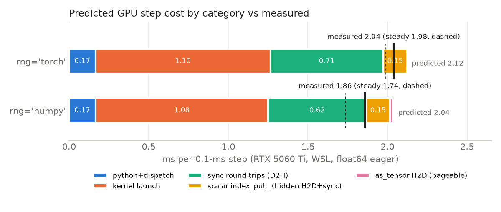

# Week 4 Day 3 (perf T1): where the GPU step goes

Brief: [progress/week4/tasks/T1_brief.md](../progress/week4/tasks/T1_brief.md).
Code: `bench/w4_overhead.py` (measurements, JSON + MD), `bench/w4_overhead_plot.py` (PNG),
`bench/w4_overhead_compare.py` (run-to-run table).
Results: `perf/results/w4/` (`results/` is gitignored, so the JSON/MD/PNG are committed here).
Reported run: `perf/results/w4/DESKTOP-4C13T5V_20261118-1022_overhead.{json,md}`; four more runs
for repeatability in `perf/results/w4/repeats/`, summarised in `perf/results/w4/repeatability.md`.

Setup: RTX 5060 Ti (sm_120), driver 610.88, WSL 3.0.5.0 (kernel 6.18.58.1), torch 2.11.0+cu128,
Python 3.12.3, 6 CPU threads. main's `sim/lif_torch.py` (unmodified), bench-pack bundle
`cns_bundle_calib.npz` (n = 165,122, nnz = 24.5 M), looming stimulus (311 sensory neurons),
gap + APL + presyn on, float64, eager. Steps are timed by wrapping `lif_torch._decay` (first call
of each step) from the bench script, so CSC upload / setup is excluded. Counts and timings use a
warm network: 1000 steps first (`return_state=True`), then 200 steps resumed from that state
(steps 1-199 of the window are measured, 10 repeats = 1,990 steps).

## Budget (cuda, reported run)

Predicted = sum over the aten ops of one step of (count x unit cost); unit costs from items 1-4.

| category (ms/step) | rng='numpy' | rng='torch' |
|---|---|---|
| Python + aten dispatch (117 ops x 1.4 us, item 1 on CPU) | 0.17 | 0.17 |
| Kernel launch, GPU-paced (105-106 kernels x 10.3 us, item 1 on CUDA minus dispatch) | 1.08 | 1.10 |
| Sync round trips, D2H (3 `_local_scalar_dense`, 1 `nonzero`, 1-2 bool-mask `index`) | 0.62 | 0.71 |
| Scalar `x[idx] = c` (4 per step, hidden H2D + sync) | 0.15 | 0.15 |
| `as_tensor` H2D of Poisson hits (pageable) | 0.02 | 0 |
| **Predicted** | **2.04** | **2.12** |
| Measured, mean of all steps | 1.86 | 2.04 |
| Measured, steady state (steps <= 5 ms) | 1.74 | 1.98 |
| Stalls (steps > 5 ms; ~11 ms each) | 1.4% of steps, 0.15 ms/step | 0.6% of steps, 0.07 ms/step |
| Predicted / measured mean | 1.10 | 1.04 |
| Predicted / steady state | 1.17 | 1.07 |

Both modes agree within +/-20% in the reported run, against both the all-steps mean and the
steady-state mean. It does not hold in every run (5 runs, `perf/results/w4/repeatability.md`):

- Against the **steady-state** mean (1.65-1.98 ms, stable) the prediction is 0.66-1.17x; within
  +/-20% for both modes in 4 of 5 runs (1029 numpy sits at exactly 0.80). The outlier (run 1036,
  0.66x) is the run where item 1 landed in its fast regime (5.4 us/kernel instead of 11.7), so the
  launch category shrank to ~0.55 ms. The step itself did not get faster, so the per-kernel cost a
  step pays is not the 1-element-kernel rate in that regime. Likely missing piece (not measured):
  GPU execution time of the step's 165,122-element float64 kernels, which the 1-element micro
  benchmark does not include.
- Against the **all-steps** mean (1.84-2.56 ms) only the reported run is within +/-20%; the gap in
  the others is the stalls (steps of ~11 ms, 0.6-9.4% of steps), which the model does not contain.

## Per-step counts (item 6, warm window, 16.5-17 spikes/step)

| | cuda numpy | cuda torch | cpu numpy | cpu torch |
|---|---|---|---|---|
| aten ops dispatched | 117.2 | 117.5 | 116.2 | 117.2 |
| of which launch GPU work | 105.2 | 106.5 | - | - |
| syncs (sync-debug warnings) | 10.0 | 10.0 | - | - |
| D2H (`_local_scalar_dense`) | 3 | 3 | - | - |
| H2D (`_to_copy` from CPU) | 1 | 0 | - | - |
| measured ms/step (mean) | 1.86 | 2.04 | 0.66 | 0.69 |

Where the 10 syncs per step come from (main's `sim/lif_torch.py`, found with
`torch.cuda.set_sync_debug_mode('warn')`, attributed to the aten op and source line):

| line | code | op | syncs/step |
|---|---|---|---|
| 43 (`_CSC.gather`, called for W and presyn W) | `tot = int(lens.sum())` | `_local_scalar_dense` | 2 |
| 208 | `idx = torch.nonzero(spk).flatten()` | `nonzero` | 1 |
| 211, 212 | `last[idx] = t`, `free[idx] = False` | `index_put_` with a Python scalar | 2 |
| 229 (numpy rng) | `hit = torch.as_tensor(hit, device=device)` | `_to_copy` H2D, pageable | 1 |
| 231 (torch rng) | `hit = ix[torch.rand(...) < p]` | `index` with a bool mask | 1 |
| 234 | `gs = gs[gs >= 0]` | `index` with a bool mask | 1 |
| 242, 243 | `v[idx] = v_rst`, `g[idx] = 0.0` | `index_put_` with a Python scalar | 2 |
| 256 | `kc_rate = float(is_kc[idx].sum()) / dt` | `_local_scalar_dense` | 1 |

`idx.numel()`, `pre.numel()`, `torch.where(..., 0.0)`, `t_dev.fill_(t)`, `counts[idx] += 1` and
`repeat_interleave(..., output_size=tot)` do not sync (checked one by one before the run).

## Micro-benchmarks (reported run; medians, us)

| item | measurement | cuda | cpu |
|---|---|---|---|
| 1 | `x.add_(1)` x 10,000: host enqueue per op (no sync), batch median | 11.0 | 1.42 |
| 1 | same, with final sync (throughput) | 11.7 | 1.42 |
| 1 | single-op interval inside the batch (100,000 samples) | 4.2 | 1.39 |
| 2 | `torch.cuda.synchronize()` on idle GPU | 1.9 | - |
| 2 | `x.add_(1); x.item()` | 72 | 1.5 |
| 3 | `torch.nonzero`, n = 165,122, 0 / 100 / 2,000 true | 104 / 356 / 100 | 6.6 / 29 / 31 |
| 3 | `int(t.sum())`, n = 165,122 | 98 | 4.0 |
| 3 | bool-mask index, length 20 / 311 | 109 / 117 | 3.1 / 3.6 |
| 3 | `v[idx] = 0.5` vs `v[idx] = tensor`, 20 idx | 45 vs 7.9 | 1.4 vs 1.8 |
| 4 | `as_tensor(int64[10/100/1000], device)` pageable | 34 / 30 / 87 | 0.8 |
| 4 | pinned buffer + `.to(non_blocking=True)`, enqueue / with sync, 10 | 5.5 / 50 | - |
| 5 | 50 tiny kernels eager, with sync | 349 | - |
| 5 | same 50 kernels as one CUDA-graph replay, with sync / enqueue only | 177 / 10.1 | - |

CUDA-graph capture works in WSL (replay checked: +50 on the counter). All items use >= 1,000
repeats (item 1: 100 batches of 10,000 ops); p90s are in the run's MD/JSON.

## Repeatability and >2x variance (reported, not averaged away)

Five full runs, same commit, back to back (`perf/results/w4/repeatability.md`, made with
`bench/w4_overhead_compare.py`):

- **CPU** micro-benchmarks: within 1.1x between runs for most items, up to 1.8x for `nonzero`.
- **CUDA** micro-benchmarks: most are stable within 1.1-1.5x (`synchronize()` 1.9 us, `add+item`
  72-79 us, `int(t.sum())` 95-105 us, scalar `v[idx] = c` 36-45 us, pageable `as_tensor` 30-35 us,
  single-op enqueue 4.1-4.5 us). **These vary by more than 2x between runs:** item 1 per-kernel
  rate 5.3-11.7 us/op (and >2x between chunks within a run in 3-4 of 5 runs, so it is bimodal at
  ~5 or ~11 us), `nonzero` with 0 or 100 true 98-360 us, `as_tensor` of 1,000 ints 30-100 us,
  pinned 1,000-int enqueue 5.6-48 us, graph replay with sync 76-177 us. The slow value shows up for
  a whole item in one run, then not in the next. GPU clocks (nvidia-smi every 0.5 s) were P1 at
  ~2.7 GHz while the benchmark ran, with P3/P5/P8 between phases; the cause of the slow regime is
  not established.
- **Simulator steps**: steady-state ms/step is stable (1.65-1.98 ms over 10 run x mode cells), but
  stalls of ~11 ms hit 0.6-9.4% of steps, so the all-steps mean ranges 1.84-2.56 ms. In two earlier
  scratch runs (not committed) stall fractions were higher, and the all-steps mean reached 3.1-3.2 ms.
- **main vs the 3.3 ms of 2026-11-16**: re-running the bench-pack method (0.2 s, float64 eager,
  setup included, median of 3) with main's `sim/` gives 1.91-2.49 ms/step for rng='torch' (the mode
  the 3.3 ms used) and 1.89-2.86 ms for rng='numpy' over the 5 runs, i.e. 25-43% below 3.33 ms for
  rng='torch'. Both numbers are reported. main's extra code only runs on resume, so it cannot make
  a fresh run faster; the difference is most likely the same stall/regime variation, not the code
  (unverified: the old copy was not re-run).

## Hypothesis check

- **Host-bound: held.** Every cost in the budget is per-op host/latency cost; the prediction from
  micro-benchmarks matches the steady-state step within +/-20% in 4 of 5 runs (0.66-1.17x).
  GPU utilisation sampled by nvidia-smi at full clocks (P1) averages 19% over the repeat runs. No single GPU kernel dominates: the same
  step does all its real work on 6 CPU threads in 0.66 ms.
- **Sync sites: partly held.** `int(lens.sum())` (2/step), `torch.nonzero` (1), `float(is_kc[idx].sum())`
  (1) and the rng='numpy' upload (1) sync, as suspected. `idx.numel()` and `pre.numel()` do **not**
  (they read metadata). **Not in the hypothesis:** the four `x[idx] = python_scalar` assignments
  each do a hidden scalar H2D copy + sync (4/step), and the two bool-mask indexes (rng='torch'
  drive, gap spikelets) sync (1-2/step). Total 10 syncs/step in both rng modes.
- **"N_ops x (dispatch + launch)": held, but launch is the larger part.** Python + aten dispatch is
  only ~1.4 us/op (0.17 ms/step). The per-kernel cost a step actually pays is ~5-12 us, the rate at
  which the GPU retires tiny kernels on WSL (host enqueue alone is 4.2 us/op; with 10,000 ops the
  queue fills and the host runs at the GPU's pace). This is ~55% of the step.
- **WSL makes syncs expensive: plausible, unverified.** A D2H round trip (`.item()` after one op)
  costs 60-80 us here and a sync-forcing op 40-100 us (up to 360 us in the slow regime);
  `synchronize()` on an idle GPU is only 2 us. No native-Linux numbers to compare on this PC.
- **rng='numpy' upload: held but small** (1 pageable H2D, ~0.02 ms/step beyond its sync).

## Conclusions and Week 5 targets

- **Remove the 10 syncs/step -> expect about -0.75 to -0.85 ms/step (to ~1.2 ms steady).**
  Cheapest first: write the four scalar assignments as tensor fills (`index_fill_` or a device
  scalar), -4 syncs, ~-0.15 ms; keep `kc_rate` on the device (-1); give `gather` an upper bound
  instead of `int(lens.sum())` (-2); fixed-size masks instead of bool-mask indexing / `nonzero` (-3).
- **A sync-free step can be CUDA-graph captured -> target <= 0.5 ms/step.** 50 tiny kernels cost
  ~330-560 us eager vs ~76-177 us as one graph replay (2-7x), and the step launches ~106 kernels
  (~1.1 ms today). Graph capture needs fixed shapes, so it depends on the target above; this would
  also beat the 6-thread CPU (0.66 ms).
- **Fewer kernels (fusion) is the other lever:** torch.compile / a Triton kernel for the per-step
  elementwise and index work; each kernel removed saves ~10 us on this machine.
- **Python dispatch is not the problem** (0.17 ms/step): no case for a C++ rewrite.
- **Stalls (~11 ms steps, 0.6-9.4% of steps in the committed runs, WSL) are outside the model.** Week 5 should report the
  stall fraction next to every ms/step and, if possible, measure once on native Linux to separate
  WSL cost from the simulator.
