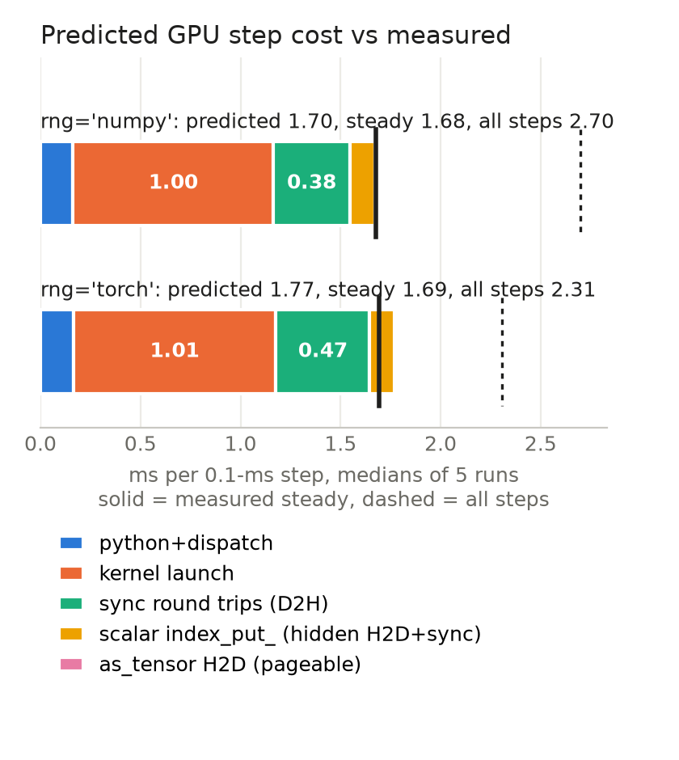

# Week 4 Day 3 (perf T1): where the GPU step goes

Brief: [progress/week4/tasks/T1_brief.md](../progress/week4/tasks/T1_brief.md); revision:
[progress/week4/tasks/T1_revision.md](../progress/week4/tasks/T1_revision.md).
Code: `bench/w4_overhead.py` (all items, `--runs 5` repeats the whole suite in one invocation and
aggregates; JSON + MD), `bench/w4_overhead_plot.py` (PNG and the HTML budget table used by the site).
Results: `perf/results/w4/DESKTOP-4C13T5V_20261118-1101_overhead.{json,md}`, `..._budget.png`,
`..._budget_table.html` (`results/` is gitignored, so they are committed under `perf/results/`).

Setup: RTX 5060 Ti (sm_120), driver 610.88, WSL 3.0.5.0 (kernel 6.18.58.1), torch 2.11.0+cu128,
Python 3.12.3, 6 CPU threads. main's `sim/lif_torch.py` (unmodified), bench-pack bundle
`cns_bundle_calib.npz` (n = 165,122, nnz = 24.5 M), looming stimulus (311 sensory neurons),
gap + APL + presyn on, float64, eager. Steps are timed by wrapping `lif_torch._decay` (first call
of each step) from the bench script, so CSC upload / setup is excluded. Counts and timings use a
warm network: 1000 steps first (`return_state=True`), then 200 steps resumed from that state
(steps 1-199 measured, 10 repeats = 1,990 steps per run).

**How to read the numbers:** the whole suite ran 5 times in one invocation. Each value below is
the median across the 5 runs, with [min-max across runs]. Inside a run, each timing is itself a
median of >= 1,000 repeats.

## Budget (cuda, ms per 0.1-ms step)

Predicted = sum over the aten ops of one step of (count x unit cost). The category rows use unit
costs that are medians across the 5 runs (and, for `nonzero`, bool-mask index, scalar assignment
and `as_tensor`, across the measured sizes too), times the median per-step counts.

| category (ms/step) | rng='numpy' | rng='torch' |
|---|---|---|
| Python + aten dispatch (117 ops x 1.39 us) | 0.16 | 0.16 |
| Kernel launch, GPU-paced (105-106 kernels x 9.5 us) | 1.00 | 1.01 |
| Sync round trips, D2H (3 `_local_scalar_dense`, 1 `nonzero`, 1-2 bool-mask `index`) | 0.38 | 0.47 |
| Scalar `x[idx] = c` (4 per step, hidden H2D + sync) | 0.13 | 0.13 |
| `as_tensor` H2D of Poisson hits (pageable) | 0.02 | 0 |
| **Predicted (units = medians across runs)** | **1.70** | **1.77** |
| Predicted per run, median [min-max] | 1.89 [1.66-2.40] | 2.04 [1.75-2.62] |
| Measured, steady state (steps <= 5 ms) | 1.68 [1.56-1.71] | 1.69 [1.60-1.78] |
| Measured, all steps | 2.70 [1.68-3.90] | 2.31 [2.00-3.73] |
| Share of stall steps (> 5 ms, ~11 ms each) | 11.0% [0.1-24.9%] | 6.6% [3.7-21.0%] |
| Predicted / steady, per run | 1.10 [1.06-1.44] | 1.24 [1.04-1.55] |
| Predicted (median units) / steady (median) | 1.01 | 1.05 |

- **Agreement:** the median per-run predicted/steady ratio is 1.10 for rng='numpy' (inside
  0.8-1.2) and 1.24 for rng='torch' (outside). With unit costs taken as medians across runs, the
  prediction is 1.01x / 1.05x the median steady-state step.
- **Negative costs:** none. No category is negative in any run.
- **How the units are derived:** every extra cost on top of dispatch + launch is a directly
  measured total minus the dispatch + launch already charged to the same ops, clamped at 0. No
  clamp was needed in this run. The scalar assignment is now timed directly (`v[idx] = 0.5` with 1,
  20 and 100 indices at n = 165,122); it is no longer the difference of two medians.
- **The all-steps mean is not predicted:** stalls (below) add 0.6-2.1 ms/step on average, and the
  model has no term for them.
- **Unstable categories:** across runs, kernel launch (0.44-1.14 ms), the sync row and the scalar
  assignment row vary by more than 2x. They inherit the regime switches of their unit costs (see
  Variability).
- **Rerun spread:** an earlier full 5-run invocation (10:54, lost before it was saved because I
  deleted its output folder while it ran) gave median ratios of 0.86 (numpy) and 0.87 (torch). The
  ratio moves by about ±0.2 between invocations.

## Per-step counts (item 6, warm window)

Counts are the same in all 5 runs.

| | cuda numpy | cuda torch | cpu numpy | cpu torch |
|---|---|---|---|---|
| spikes per step | 17.1 | 16.5 | 17.1 | 16.0 |
| aten ops dispatched | 117.2 | 117.5 | 116.2 | 117.2 |
| of which launch GPU work | 105.2 | 106.5 | - | - |
| syncs (sync-debug warnings) | 10.0 | 10.0 | - | - |
| D2H (`_local_scalar_dense`) | 3 | 3 | - | - |
| H2D (`_to_copy` from CPU) | 1 | 0 | - | - |
| measured ms/step, steady [range] | 1.68 [1.56-1.71] | 1.69 [1.60-1.78] | 0.62 [0.59-0.65] | 0.60 [0.55-0.65] |

Where the 10 syncs per step come from (main's `sim/lif_torch.py`, found with
`torch.cuda.set_sync_debug_mode('warn')`, attributed to the aten op and source line):

| line | code | op | syncs/step |
|---|---|---|---|
| 43 (`_CSC.gather`, called for W and presyn W) | `tot = int(lens.sum())` | `_local_scalar_dense` | 2 |
| 208 | `idx = torch.nonzero(spk).flatten()` | `nonzero` | 1 |
| 211, 212 | `last[idx] = t`, `free[idx] = False` | `index_put_` with a Python scalar | 2 |
| 229 (numpy rng) | `hit = torch.as_tensor(hit, device=device)` | `_to_copy` H2D, pageable | 1 |
| 231 (torch rng) | `hit = ix[torch.rand(...) < p]` | `index` with a bool mask | 1 |
| 234 | `gs = gs[gs >= 0]` | `index` with a bool mask | 1 |
| 242, 243 | `v[idx] = v_rst`, `g[idx] = 0.0` | `index_put_` with a Python scalar | 2 |
| 256 | `kc_rate = float(is_kc[idx].sum()) / dt` | `_local_scalar_dense` | 1 |

These do not sync (each checked on its own before the run): `idx.numel()`, `pre.numel()`,
`torch.where(..., 0.0)`, `t_dev.fill_(t)`, `counts[idx] += 1` and
`repeat_interleave(..., output_size=tot)`.

## Micro-benchmarks (medians across 5 runs [min-max], us)

| item | measurement | cuda | cpu |
|---|---|---|---|
| 1 | `x.add_(1)` x 10,000: host enqueue per op, batch | 10.2 [5.4-11.4] | 1.39 [1.38-1.46] |
| 1 | same, with final sync (per-kernel rate) | 10.9 [5.6-12.1] | 1.39 [1.38-1.46] |
| 1 | single-op interval inside a batch | 4.15 [4.07-4.31] | 1.36 [1.34-1.42] |
| 2 | `torch.cuda.synchronize()` on idle GPU | 2.5 [2.0-2.5] | - |
| 2 | `x.add_(1); x.item()` | 79 [74-163] | 1.50 [1.49-1.51] |
| 3 | `torch.nonzero`, n = 165,122, 0 / 100 / 2,000 true | 103 / 333 / 106 (each 98-363) | 4.9 / 16 / 31 |
| 3 | `int(t.sum())`, n = 165,122 | 98 [96-229] | 4.9 [3.9-6.2] |
| 3 | bool-mask index, length 20 / 311 | 117 [108-386] / 99 [92-118] | 3.4 / 3.6 |
| 3 | `v[idx] = 0.5`, 1 / 20 / 100 idx | 44 / 44 / 37 (each 36-166) | 1.35 / 1.38 / 1.49 |
| 3 | `v[idx] = tensor`, 1 / 20 / 100 idx (reference only) | 9.3 / 8.4 / 5.5 (each 5.4-88) | 1.32 / 1.15 / 1.25 |
| 4 | `as_tensor(int64[10/100/1000], device)` pageable | 31 / 35 / 36 (30-92) | 0.83 |
| 4 | pinned + `.to(non_blocking=True)`, enqueue, 10 / 100 / 1000 | 5.5 / 8.4 / 8.4 (5.4-87) | - |
| 4 | same, with sync | 51 / 51 / 52 (47-104) | - |
| 5 | 50 tiny kernels eager, with sync | 327 [318-341] | - |
| 5 | one CUDA-graph replay of the same 50, with sync / enqueue only | 75 [74-175] / 10.6 [10.1-161] | - |

CUDA-graph capture works in WSL in all 5 runs (each replay was checked). Per run, the replay is
1.9-4.5x faster than eager, median 4.4x. The p90 values are in the run's MD/JSON.

## Variability (reported, not averaged away)

**Values that varied more than 2x across the 5 runs** (max/min of the per-run medians):

| value | median | min | max | max/min |
|---|---|---|---|---|
| cuda item 1 enqueue per op (us) | 10.2 | 5.4 | 11.4 | 2.1 |
| cuda item 1 per-kernel rate with sync (us) | 10.9 | 5.6 | 12.1 | 2.2 |
| cuda `add_ + item` (us) | 79 | 74 | 163 | 2.2 |
| cuda `nonzero` 0 / 100 / 2,000 true (us) | 103 / 333 / 106 | 98 / 106 / 98 | 352 / 363 / 361 | 3.4-3.7 |
| cuda `int(t.sum())` (us) | 98 | 96 | 229 | 2.4 |
| cuda bool-mask index, length 20 (us) | 117 | 108 | 386 | 3.6 |
| cuda scalar `v[idx] = c`, 1 / 20 / 100 idx (us) | 44 / 44 / 37 | 36-37 | 161-166 | 4.4-4.6 |
| cuda tensor `v[idx] = t`, 1 / 20 / 100 idx (us) | 9.3 / 8.4 / 5.5 | 8.6 / 5.4 / 5.4 | 88 / 83 / 82 | 10-15 |
| cuda pageable `as_tensor` 10 / 1000 (us; with sync: 3.3-3.5x) | 31 / 36 | 30 / 30 | 87 / 92 | 2.9 / 3.1 |
| cuda pinned enqueue 10 / 1000 (us) | 5.5 / 8.4 | 5.4 / 5.5 | 87 / 48 | 15.9 / 8.7 |
| cuda pinned 1000 with sync (us) | 52 | 51 | 104 | 2.0 |
| cuda graph replay with sync / enqueue (us) | 75 / 10.6 | 74 / 10.1 | 175 / 161 | 2.4 / 16.0 |
| cuda stall fraction, numpy / torch | 11.0% / 6.6% | 0.1% / 3.7% | 24.9% / 21.0% | 497 / 5.7 |
| cuda all-steps mean ms/step, numpy | 2.70 | 1.68 | 3.90 | 2.3 |
| budget categories: launch / D2H sync / scalar assignment (ms, numpy) | 1.00 / 0.53 / 0.12 | 0.44 / 0.38 / 0.09 | 1.12 / 1.01 / 0.63 | 2.6 / 2.7 / 6.9 |

The generated MD lists every flagged value automatically (`## Variability` in
`perf/results/w4/DESKTOP-4C13T5V_20261118-1101_overhead.md`).

**Under 2x, still listed:**
- The cuda all-steps mean for rng='torch' (2.31 [2.00-3.73], 1.9x).
- The bench-pack-method ms/step (below; 1.4-1.6x).
- The CPU micro-benchmarks. No CPU item varied by 2x. The widest are `nonzero` with 2,000 true
  (1.72x), `int(t.sum())` (1.57x), bool-mask index of 20 (1.58x) and scalar `v[idx] = c` with
  1 index (1.55x). The rest are within 1.06x.
- The CPU stall fraction (0 to 0.4%).

**The pattern:** CUDA micro-benchmarks switch between a fast and a slow regime. One run gets a
slow value for a whole item, and the next run does not. Item 1 is also bimodal within a run: its
100 batches sit near 5 or near 11 us/op, and it trips the within-run 2x flag in 3 of 5 runs. The
cause is not established; GPU clocks were P1 at ~2.7 GHz during the runs. The **steady-state
simulator step is stable** (1.56-1.78 ms). What varies is how many steps stall.

## main vs the 3.3 ms of 2026-11-16

- **Re-run of the bench-pack method** (0.2 s, float64 eager, setup and warm-up included, median of
  3 repeats) with main's `sim/`: 2.50 [1.95-2.74] ms/step for rng='torch', the mode the 3.3 ms
  used, and 2.51 [1.77-2.77] for rng='numpy'. That is 18-41% below 3.33 ms, so both are reported.
- **What the 3.3 ms contained:** it is an all-steps number, with setup, warm-up (the first ~18
  steps have no synaptic events) and stalls inside it. The steady-state step is ~1.6-1.8 ms.
- **Code difference:** main's extra save/resume code only runs on resume, so it cannot make a
  fresh run faster. This was not checked by re-running the old copy.

## Hypothesis check

- **Host-bound: held.**
  - With units = medians across runs, the prediction from micro-benchmarks is within 1.01-1.05x of
    the median steady-state step. Per run it is 1.04-1.55x, with a median of 1.10 / 1.24.
  - GPU utilisation (measured later in T3: nvidia-smi `utilization.gpu`, 100 ms samples while
    `run_trial` steps for >= 2 s) is 19% median, 3-22% across 5 runs; see
    [week04_day4.md](week04_day4.md). (This line first said "around 20%" without a measurement.)
  - No single GPU kernel dominates: the same step does its real work on 6 CPU threads in 0.6 ms.
- **Sync sites: partly held.**
  - As suspected, these sync: `int(lens.sum())` (2/step), `torch.nonzero` (1),
    `float(is_kc[idx].sum())` (1) and the rng='numpy' upload (1).
  - `idx.numel()` and `pre.numel()` do **not** sync; they read metadata.
  - **Not in the hypothesis:** the four `x[idx] = python_scalar` assignments each do a hidden
    scalar H2D copy plus a sync (4/step). The two bool-mask indexes (rng='torch' drive, gap
    spikelets) also sync (1-2/step).
  - Total: 10 syncs/step in both rng modes.
- **"N_ops x (dispatch + launch)": held, but launch is the larger part.**
  - Python + aten dispatch is ~1.4 us/op, 0.16 ms/step.
  - The per-kernel cost a step pays is the rate at which the GPU retires tiny kernels on WSL:
    ~10 us in the slow regime, ~5.5 us in the fast one. Host enqueue alone is 4.1 us/op.
  - Launch is ~1.0 ms, about 60% of the predicted step.
- **WSL makes syncs expensive: plausible, unverified.**
  - A D2H round trip (`.item()` after one op) costs 74-163 us here, and a sync-forcing op
    ~100 us (up to ~360 us in the slow regime).
  - `synchronize()` on an idle GPU is 2-2.5 us.
  - There are no native-Linux numbers on this PC to compare.
- **rng='numpy' upload: held, but small.** One pageable H2D per step, ~0.02 ms/step beyond its sync.

## Conclusions and Week 5 targets

- **The 3.3 ms of 2026-11-16 is not the step cost.** It includes setup, warm-up and stalls. The
  steady-state step on this GPU is ~1.6-1.8 ms. Separately, stalls of ~11 ms hit 0.1-25% of steps
  under WSL, changing from run to run. **Week 5 should report steady ms/step and stall fraction as
  separate numbers** (as `w4_overhead.py` does) and never a single mean.
- **Remove the 10 syncs/step -> expect about -0.5 to -0.6 ms/step steady (to ~1.1-1.2 ms).** This is the
  sync row plus the scalar-assignment row with median units.
  - Write the four scalar assignments as tensor fills (`index_fill_`, or a device scalar): -4
    syncs, ~-0.13 ms.
  - Keep `kc_rate` on the device: -1.
  - Give `gather` an upper bound instead of `int(lens.sum())`: -2.
  - Use fixed-size masks instead of bool-mask indexing and `nonzero`: -3.
- **A sync-free step can be CUDA-graph captured -> target <= 0.5 ms/step steady.**
  - The step launches ~106 kernels (~1.0 ms today).
  - 50 tiny kernels cost ~330 us eager vs ~75 us as one graph replay (median 4.4x, 1.9-4.5x per
    run).
  - Graph capture needs fixed shapes, so it depends on removing the syncs first.
  - At 0.5 ms the GPU step would beat the 6-thread CPU (0.6 ms).
- **Fewer kernels (fusion) is the other lever:** torch.compile or a Triton kernel for the per-step
  elementwise and index work. Each kernel removed saves ~5-10 us on this machine.
- **Python dispatch is not the problem** (0.16 ms/step): there is no case for a C++ rewrite.
