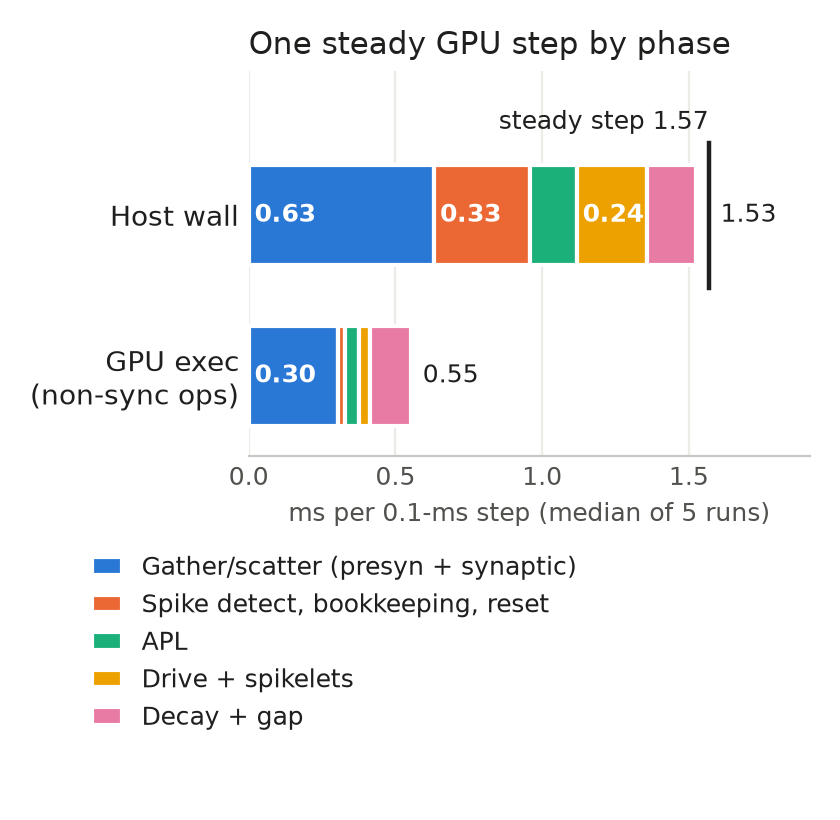
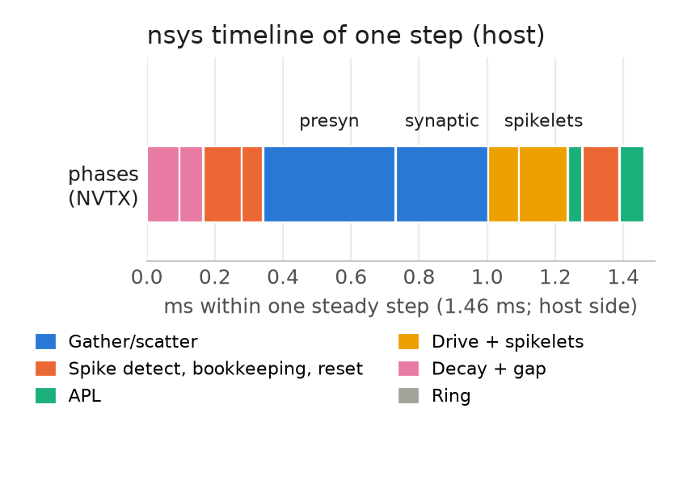

# Week 4 Day 4 (perf T3): anatomy of one steady GPU step

Brief: [progress/week4/tasks/T3_brief.md](../progress/week4/tasks/T3_brief.md).
Code: `bench/w4_anatomy.py` (instrumented step loop, all passes, `--runs 5`, JSON + MD),
`bench/w4_anatomy_plot.py` (stacked bar PNG and the HTML phase table that the site embeds),
`bench/w4_nsys_timeline.py` (one step from an nsys export, as a PNG).
Results: `perf/results/w4/DESKTOP-4C13T5V_20261118-1146_anatomy.{json,md}`, `..._anatomy_phases.png`,
`..._anatomy_phases_table.html`, `..._timeline_nvtx.nsys-rep`, `..._timeline_nvtx_osrt.nsys-rep`,
`..._timeline_step.png`.

Setup: same machine and bundle as T1 (RTX 5060 Ti sm_120, driver 610.88, WSL 3.0.5.0, torch
2.11.0+cu128, `cns_bundle_calib.npz`, looming, gap + APL + presyn, float64, eager, rng='numpy').
Window: 1000 warm steps (`return_state=True`), then 200 steps resumed from that state; steps
1-199 measured, 10 repeats per pass. Steps over 5 ms are stalls and are left out of the phase
statistics. The whole suite ran 5 times in one invocation: every value is the median across runs
[min-max across runs].

## Method

`bench/w4_anatomy.py` holds a copy of the `run_trial` step loop (main's `sim/lif_torch.py` lines
201-256) for the bundle configuration. It calls the same helpers (`lif_torch._decay`,
`lif_torch._CSC`) and keeps the statement order, with boundary markers between phases. `sim/` is
not changed.

| phase | lines in `sim/lif_torch.py` |
|---|---|
| decay | 202 |
| gap | 203-206 |
| threshold+nonzero | 207-209 |
| bookkeeping (`last`/`free`) | 210-212 |
| presyn | 213-219 (incl. `ps_W.colsum`, i.e. `_CSC.gather` + `index_add_`) |
| synaptic gather+scatter | 220-222 (`Wd.colsum`) |
| drive (Poisson) | 223-232 |
| spikelets | 233-237 |
| apl | 238-240, plus line 256 (`kc_rate = float(...)`, end of step, timed as a second segment) |
| reset | 241-244 |
| ring | 254 |

Passes, each from the same warm state:

- **reference:** `lif_torch.run_trial` itself, step-timed as in T1.
- **host:** the copy with `perf_counter` at every boundary only. **The wall column comes from this
  pass.**
- **events:** `perf_counter` + `torch.cuda.Event.record` + `torch.cuda.nvtx` range per phase.
  The GPU span is the event-to-event time.
- **gated:** GPU execution time per aten op. Before every aten op that touches the GPU, a
  `torch.cuda._sleep` of 1 ms is enqueued, then an event; a second event follows the op. The host
  enqueues the op while the GPU sleeps, so the span is the op's kernel time, not paced by the
  host. The pass checks that no op took the host longer than the gate to enqueue (0 of ~5,000 ops
  in every run). The 10 sync-forcing ops are summed separately, because their span also holds the
  copy round trip and the host returning from the sync.
- **counts:** aten ops that launch GPU work (`TorchDispatchMode`, T1's classification) and syncs
  (`torch.cuda.set_sync_debug_mode('warn')`) per phase. The gated pass classifies the sync ops by
  op and argument; per phase this matches the sync-debug count in all 5 runs.
- **util:** `nvidia-smi --query-gpu=timestamp,utilization.gpu,clocks.gr,pstate -lms 100` runs in
  the background for the whole run. The utilisation number uses the samples inside a window in
  which `run_trial` steps for >= 2 s (1,450 steps, setup excluded).

**Drift guard: passed.** 300 steps from t = 0 (seed 0, rng='numpy', float64): the copy, with
events and NVTX on, gives exactly `run_trial`'s spike counts (3,710 spikes, 0 neurons differ).
Every repeat of every pass also matched `run_trial`'s counts for the warm window (3,438 spikes).

## Phase table (ms per step, steady steps)

| phase | wall | wall p90 | GPU span (events) | GPU exec, non-sync ops | sync-op span (upper bound) | syncs | GPU ops |
|---|---|---|---|---|---|---|---|
| presyn | 0.324 [0.316-0.341] | 0.422 | 0.385 | 0.158 | 0.120 | 1 | 29 |
| synaptic gather+scatter | 0.308 [0.306-0.416] | 0.471 | 0.339 | 0.146 | 0.132 | 1 | 25 |
| apl | 0.161 [0.148-0.174] | 0.209 | 0.216 | 0.047 | 0.108 | 1 | 9 |
| threshold+nonzero | 0.151 [0.141-0.211] | 0.254 | 0.140 | 0.010 | 0.151 | 1 | 3 |
| spikelets | 0.121 [0.121-0.135] | 0.181 | 0.127 | 0.010 | 0.148 | 1 | 3 |
| drive | 0.117 [0.113-0.130] | 0.175 | 0.123 | 0.027 | 0.067 | 1 | 6 |
| reset | 0.101 [0.097-0.109] | 0.139 | 0.102 | 0.015 | 0.164 | 2 | 5 |
| decay | 0.097 [0.093-0.113] | 0.139 | 0.161 | 0.084 | 0 | 0 | 14 |
| bookkeeping | 0.073 [0.072-0.077] | 0.106 | 0.107 | 0.000 | 0.158 | 2 | 2 |
| gap | 0.072 [0.070-0.082] | 0.107 | 0.105 | 0.056 | 0 | 0 | 9 |
| ring | 0.000 | 0.001 | 0.002 | 0 | 0 | 0 | 0 |
| **sum** | **1.519 [1.488-1.741]** | | | **0.558 [0.555-0.560]** | 1.096 [0.963-1.224] | **10** | **105** |

The p90, GPU-span, GPU-exec and sync-span columns show medians across runs; their ranges are in
the run MD. All per-phase ranges are within 1.4x.

| step | value |
|---|---|
| steady step, host pass | 1.568 [1.520-1.806] |
| **sum of phase wall medians / steady step, same pass** | **0.973 [0.964-0.979]** (inside ±15%) |
| steady step, uninstrumented `run_trial` | 1.609 [1.552-1.864] |
| steady step, events + NVTX pass | 1.855 [1.716-2.045] |
| host pass / `run_trial` | 1.00 [0.82-1.12] |
| events pass / `run_trial` | 1.15 [0.92-1.29] |
| share of stall steps (> 5 ms), host pass | 7.8% [2.1-14.9%] (stall median 10.8 ms) |
| **GPU utilisation, nvidia-smi** | **19% [3-22%]** |
| **GPU exec (non-sync ops) / `run_trial` steady step** | **0.34 [0.30-0.36]** |
| GPU span (events) / wall | 1.00 [1.00-1.00] (by construction, see below) |
| GPU ops / syncs / aten ops per step | 105.2 / 10 / 117.2 (same in all runs, as in T1) |



The bar groups the 11 phases into 5 colours: gather/scatter = presyn + synaptic; spike detect,
bookkeeping, reset = threshold+nonzero + bookkeeping + reset; APL; drive + spikelets; decay + gap.
The bar totals are sums of the per-phase medians across runs (1.53 and 0.55). The table's sum row
is the median of the per-run sums (1.52 and 0.56).

**How to read the GPU columns:**

- **GPU span** is the time between the phase's start and end events on the stream. While the host
  paces the GPU, the span includes the GPU's idle gaps, so the spans tile the step and
  span / wall is 1.00 by construction. It is an upper bound on GPU work, not a busy time.
- **GPU exec** is the measured kernel time of the non-sync ops with the host hidden. Each op's span
  still includes a few µs of GPU-side launch overhead (a 1,000-element `add_` measures ~5 µs), so this
  estimate errs high.
- The sync ops' own kernels (count of `nonzero`, an 8-byte copy, one scalar H2D) are small but were
  not separated from the round trip. Their spans, 1.1 ms per step, are an upper bound dominated by
  latency. GPU busy time per step is therefore between 0.56 ms and 1.65 ms; the nvidia-smi figure
  and the size of those kernels put it near the low end.

**Events cost:** recording 13 events per step adds ~0.25 ms per step here (events pass 1.86 vs host
pass 1.57 ms). Against T1's 1.65-1.73 ms, the events pass is +7 to +12% at the median and +24% in
its slowest run (2.045 ms): inside the brief's 25% stop condition. Against the same run's
uninstrumented `run_trial`, one run was +29% (2.045 vs 1.585 ms). This is why the wall column
comes from the host-only pass, which matches `run_trial` (1.00 [0.82-1.12]).

## Timeline (nsys)



- **nsys is installed** (WSL: `/usr/local/cuda/bin/nsys`, Nsight Systems 2024.6.2, from the CUDA
  12.8 toolkit). **It cannot trace the GPU on this setup.** The capture's diagnostics say
  "Installed CUDA driver version (13.3) is not supported by this build of Nsight Systems", then
  `CUPTI_ERROR_INVALID_DEVICE` and "No CUDA events collected". That is the same CUPTI error as
  torch.profiler. There are no kernel rows. Native Windows has no Nsight Systems install.
- **What was captured:** 200 steady steps with NVTX ranges (capture range = NVTX range `window`).
  - `..._timeline_nvtx.nsys-rep` (NVTX only). The step drawn is the median step, 1.46 ms.
  - `..._timeline_nvtx_osrt.nsys-rep` (NVTX + OS runtime). OS-runtime tracing slows the step to a
    1.94 ms median.
  - The PNG is rendered from the NVTX-only export by `bench/w4_nsys_timeline.py`. It is not a GUI
    screenshot: there is no GUI here.
- **In the OS-runtime capture**, the median step has a single OS call over 20 µs: one 39 µs
  `ioctl`. The 10 sync waits do not show up as blocking system calls. This is one step, not a
  survey, so it is not evidence about how the driver waits.
- **To get GPU rows (not run, per the brief):** install a newer Nsight Systems in WSL. The CUDA
  apt repo already configured there lists 2025.1.3 to 2026.1.3:

  ```
  sudo apt-get install -y nsight-systems-2026.1.3
  ```

  Then run it as `/opt/nvidia/nsight-systems/2026.1.3/bin/nsys profile -t cuda,nvtx ...`
  (command in the `w4_anatomy.py` docstring). Whether the newer version gets CUPTI working under
  WSL with driver 13.3 is **untested**.

## Hypothesis check

**(a) Gather/scatter and the spike phase hold most of the wall time because of their syncs: the
share held, the reason only half held.**

- **Top 3 phases by wall time:**
  - presyn: 0.324 ms, 1 sync, 29 GPU ops.
  - synaptic gather+scatter: 0.308 ms, 1 sync, 25 GPU ops.
  - apl: 0.161 ms, 1 sync, 9 GPU ops.
  - Next come threshold+nonzero (0.151 ms, 1 sync) and spikelets (0.121 ms, 1 sync).
- **The share:** gather/scatter (presyn + synaptic, 0.63 ms) plus the spike phase
  (threshold+nonzero + bookkeeping + reset, 0.33 ms) make up 0.96 of 1.52 ms, or 63% of the step.
  They hold 7 of the 10 syncs (2 + 5), not 6.
- **Gather/scatter is slow because of its kernel count, not its syncs.** It has 1 sync per matrix,
  54 of the 105 GPU ops, and 0.30 ms of GPU exec. That is the largest GPU share of any phase.
- **The spike phase is slow because of its syncs.** It has 5 syncs and almost no GPU work
  (0.025 ms exec in 0.33 ms wall). Bookkeeping's two ops are both scalar assignments that sync.

**(b) The GPU is busy well under 50% of the wall time: held.**

- nvidia-smi utilisation is 19% [3-22%].
- The kernel time of the non-sync ops is 0.56 ms per step, 0.34 [0.30-0.36] of the uninstrumented
  steady step. The sync ops add a small amount of kernel work on top.
- T1's "~20%" was not measured at the time. The measured value happens to be close, and
  `perf/week04_day3.md` now cites this measurement instead.

## Variability (values that varied more than 2x across runs)

| value | median | min | max | max/min |
|---|---|---|---|---|
| stall share, `run_trial` | 5.0% | 3.0% | 18.1% | 6.0 |
| stall share, host pass | 7.8% | 2.1% | 14.9% | 7.1 |
| stall share, events pass | 6.3% | 4.7% | 21.1% | 4.5 |
| GPU utilisation (%) | 19 | 3 | 22 | 7.3 |
| utilisation window length (s, 1,450 steps) | 3.2 | 2.4 | 8.4 | 3.5 |

- **No per-phase median varied more than 1.4x across runs.**
- **Utilisation falls when stalls rise.** The two low readings (3% and 8%) are the two runs in which
  the 1,450 steps took 8.4 s and 4.2 s instead of 2.4-3.2 s, so most of those windows were
  stalls. This suggests the GPU is idle during a stall. It is an observation, not an established
  cause.
- **GPU clocks:** the GPU drops to P3/P5 (682-1,350 MHz) when idle between passes. It runs at
  2.5-2.77 GHz while stepping.
- **An earlier, discarded invocation** (11:41) used a 0.3 ms gate with no host-enqueue check. In
  one of its runs, the gated GPU exec read 7.3 ms per step instead of 0.56, with every op ~12x
  slower. I could not reproduce this in six isolated gated passes. The gate is now 1 ms, and the
  pass checks host enqueue against the gate (and would repeat itself). I also rendered a plot on
  the CPU during that invocation, which this one avoided.

## Conclusions and Week 5 targets

- **Gather/scatter (presyn + synaptic) is the biggest phase on both axes:** 0.63 ms wall, 54 GPU
  ops, 0.30 ms GPU exec, 2 syncs.
  - Week 5: replace `int(lens.sum())` with a static upper bound (a fixed-size buffer sized by the
    maximum spikes x out-degree), so both colsums become capturable.
  - Then fuse gather + scale + `index_add_` into one kernel per matrix.
  - Target: no syncs, ≤ 0.10 ms GPU exec for the pair.
- **The spike phase (threshold+nonzero, bookkeeping, reset) is pure sync latency:** 0.33 ms wall,
  5 syncs, 0.025 ms GPU exec. It is the cheapest win.
  - Week 5: write the scalar assignments as tensor ops (`index_fill_` or `torch.where` on a mask),
    and replace `nonzero` with a fixed-size form.
  - Target: 0 syncs, ≤ 0.05 ms in a captured step.
- **APL, drive and spikelets: 0.40 ms wall, 3 syncs, 0.08 ms GPU exec.**
  - Week 5: keep `kc_rate` on the device. Use the on-device Poisson draw as a mask (rng='torch'
    without the bool-mask index, or upload hits to a pinned fixed-size buffer). Replace
    `gs[gs >= 0]` with a masked colsum.
  - Target: 0 syncs, ≤ 0.05 ms each.
- **Decay + gap is already sync-free:** 0.17 ms wall, 23 GPU ops, 0.14 ms GPU exec. It is the
  first block to CUDA-graph capture or `torch.compile` (`compile=True` already exists for
  `_decay`). Target: ≤ 0.05 ms.
- **The GPU floor of today's kernels is ~0.56 ms per step** (non-sync exec, measured with the host
  hidden). A sync-free, graph-captured step that keeps these kernels would land near 0.5-0.6 ms.
  Getting clearly under T1's ≤ 0.5 ms target needs fusion in gather/scatter and decay+gap, not
  capture alone.
  - Keep reporting the steady step and the stall share as separate numbers. Stalls (2-15% of steps
    here, ~10.8 ms each) are untouched by any of this.
