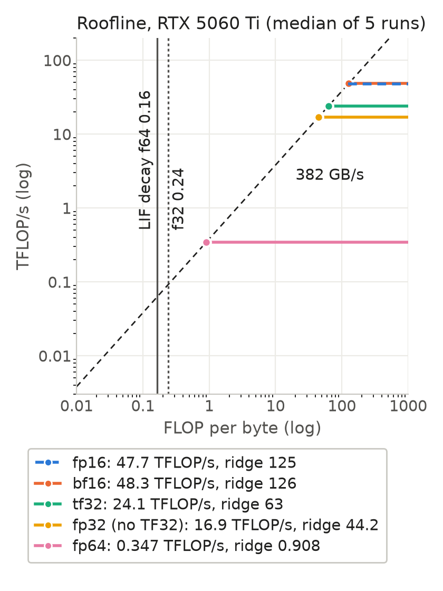

# Week 4 Day 5a (perf T4): compute roofline on the RTX 5060 Ti

Brief: [progress/week4/tasks/T4_brief.md](../progress/week4/tasks/T4_brief.md).
Code: `bench/w4_roofline.py` (matmul peaks, copy bandwidth check, LIF decay FLOP/byte count; `--runs 5`,
JSON + MD), `bench/w4_roofline_plot.py` (roofline PNG and the HTML table the site embeds).
Results: `perf/results/w4/DESKTOP-4C13T5V_20261122-1239_roofline.{json,md}`, `perf/results/w4/roofline.png`,
`perf/results/w4/DESKTOP-4C13T5V_20261122-1239_roofline_table.html`. `sim/` is not changed. No Triton kernel.

Setup: RTX 5060 Ti (sm_120, 36 SMs, 15.9 GB, 32 MB L2), driver 610.88, WSL 3.0.5.0 (kernel
6.18.58.1), torch 2.11.0+cu128 (CUDA runtime 12.8), triton 3.6.0. nvidia-smi: max SM clock 3,090 MHz,
power limit 180 W.

Method: `torch.matmul(a, b, out=c)` on square n x n `randn` matrices, n = 1,024 / 2,048 / 4,096 / 8,192 (no
size ran out of memory), for fp64, fp32 (`torch.backends.cuda.matmul.allow_tf32 = False`), tf32 (`= True`),
bf16 and fp16 (torch defaults: FP32 accumulate, reduced-precision split-K reductions allowed). Per size:
at least 10 warm-up calls (up to 50, about 1 s), then 100 timed calls back to back, one CUDA event pair per
call; TFLOP/s = 2n³ / t. Per size the median and p90 of t; the peak of a run is the best size's median. The
whole suite ran 5 times in one invocation: every value is the median across runs [min-max across runs].
Check that the TF32 flag took effect: relative error against a float64 product at n = 1,024 is 3.3e-7 with it
off and 2.9e-4 with it on.

## Peak table

| dtype | peak TFLOP/s | best n (5 runs) | spec TFLOP/s | % of spec | ridge FLOP/byte at 382 GB/s |
|---|---|---|---|---|---|
| fp16 | 47.67 [47.67-48.08] | 8192, 4096 x4 | 47.37 | 100.6% [100.6-101.5%] | 125 |
| bf16 | 48.29 [48.24-48.64] | 8192 x5 | 47.37 | 102.0% [101.8-102.7%] | 126 |
| tf32 | 24.05 [24.05-24.24] | 8192 x5 | 23.68 | 101.5% [101.5-102.3%] | 63 |
| fp32 (no TF32) | 16.88 [16.87-17.27] | 8192 x5 | 23.68 | 71.3% [71.2-72.9%] | 44 |
| fp64 | 0.347 [0.347-0.347] | 2048 x2, 4096 x3 | 0.370 | 93.8% [93.8-93.8%] | 0.91 |

Ratios: fp32 / fp64 = 48.6, tf32 / fp64 = 69, fp16 / fp64 = 137.

### Where the spec comes from

NVIDIA does not publish per-dtype TFLOP/s for the RTX 5060 Ti. Its product pages
(https://www.nvidia.com/en-us/geforce/graphics-cards/compare/#50-series and
https://www.nvidia.com/en-us/geforce/graphics-cards/50-series/rtx-5060-family/) give only 4,608 CUDA cores,
2.57 GHz boost, "759 AI TOPS" (precision not stated) and 448 GB/s. The spec column is therefore **derived**:
- NVIDIA RTX Blackwell GPU Architecture whitepaper
  (https://images.nvidia.com/aem-dam/Solutions/geforce/blackwell/nvidia-rtx-blackwell-gpu-architecture.pdf),
  Appendix C, Table 6, RTX 5070 (GB205, 48 SMs, 2,512 MHz boost), dense: FP32 non-tensor 30.9, TF32 tensor
  30.9, FP16 and BF16 tensor with FP32 accumulate 61.7, FP16 tensor with FP16 accumulate 123.5 TFLOPS. Per SM
  per clock: 256 / 256 / 512 / 1,024 FLOP.
- FP64: the same paper, GB202 section: "The FP64 TFLOP rate is 1/64th the TFLOP rate of FP32 operations"
  (2 FP64 cores per SM), i.e. 4 FLOP per SM per clock. Stated for GB202; assumed for GB206.
- Scaled to the 5060 Ti: 36 SMs (4,608 / 128, matches `multi_processor_count`) x 2.57 GHz. Cross-check: the
  5070's FP4 sparse rate (987.8) is 8x its FP16-accumulate rate; 8 x 94.7 = 758 for the 5060 Ti against the
  published 759 AI TOPS.
- torch's fp16/bf16 matmul accumulates in FP32, so the FP32-accumulate rate (47.4) is the spec used. FP16 with
  FP16 accumulate would be 94.7 TFLOP/s; torch.matmul does not reach that path.

Why the tensor dtypes sit at 101-102% of spec: the spec is at the 2.57 GHz boost clock, and the card runs
faster. nvidia-smi right after each 8,192 loop read 2.62-2.69 GHz for the tensor dtypes (max 3.09 GHz). At
2.67 GHz the bf16 roof is 49.2 TFLOP/s, so 48.3 is 98% of the clock-adjusted roof. fp32 without TF32 is
power-limited: 177-180 W of the 180 W limit with the clock down to 2.50-2.57 GHz. fp64 draws ~53 W at
2.73 GHz. None of the medians or single runs is more than 10% over spec (largest single run: bf16 102.7%).

## Clock: events, not the host

T5b rescaled CUDA event spans to the host clock, because events read 4-6% high against it. Here the host clock
is the unstable side. Over the same 100-call loops, host wall / event sum had a median of 0.956 in this
session (0.90-1.00 for n >= 2,048) (events read ~5% high, as in T5b) but 1.085 in a smoke run 40 minutes earlier, and event / host over
a 2 s idle host sleep read 1.00-1.11 from run to run. Meanwhile the raw event time of the same matmul repeats
within 1% across all runs and three sessions (fp64 n = 1,024: 0.327-0.331 TFLOP/s). So the TFLOP/s are from
the CUDA events as measured, without rescaling; the host numbers are in the JSON/MD as diagnostics
(`host_tflops`, `tflops_median_hostscaled`, `event_scale`). With host-wall timing every peak would be ~4-5%
higher (bf16 50.2, fp16 50.2, tf32 25.4, fp64 0.363 TFLOP/s), i.e. 106-107% of spec for the tensor
dtypes, still inside the 10% limit. A first full run applied the idle-sleep ratio
and is discarded for that reason (its per-run peaks moved with the 1.00-1.09 ratio; raw events were the same).
Which clock is right in absolute terms is not settled here; events are used because they repeat.

## Copy bandwidth

The roofline uses the Day 2 value, 382 GB/s (`bench/w4_bench.py`, `cuda/torch_copy`, 512 MB float32,
(read + write) / median; PC run `DESKTOP-4C13T5V_20261116-2308` under `~/flybench/flybrain/results/w4/bench/`).
The same measurement repeated in every run here: 385.9 [385.7-386.1] GB/s (86% of NVIDIA's 448 GB/s). Its p90
is bimodal: 385 GB/s in 2 runs, 198 GB/s in 3 (some copies in the slow tail take twice as long); the median
is unaffected.

## LIF decay arithmetic intensity

`sim/lif_torch._decay(v, g, last, rfc_n, t, v0, a_coef, em, es)` per neuron (`v`, `g` float; `last`, `rfc_n`
int64; `t` a 0-d tensor; `v0`, `a_coef`, `em`, `es` Python floats):

- FLOPs: 8 per neuron. `g * a_coef` (1); `v0 + (v - v0 - A) * em + A * es` (6: two subtractions, two
  multiplications, two additions); `g * es` (1). The three `torch.where` selects, the int64 `t - last` and
  the `>= rfc_n` compare count 0 FLOPs.
- Bytes, fused lower bound (each input read once, each output written once): read `v`, `g` (2 x 8 or 2 x 4),
  `last`, `rfc_n` (2 x 8); write `v`, `g` (2 x 8 or 2 x 4) and the bool `free` (1).
  **float64: 49 bytes, 0.163 FLOP/byte. float32: 33 bytes, 0.242 FLOP/byte.**
- Bytes as run today (eager, 14 aten ops, each reading its inputs and writing its output):
  float64 244 bytes (0.033 FLOP/byte), float32 140 bytes (0.057 FLOP/byte).

Counted by `decay_intensity()` in the bench: `_decay` runs on CPU under a `TorchDispatchMode` that adds up
tensor bytes in and out and one FLOP per output element of add/sub/mul/div/rsub; the counts match the hand
count above. The plot shows the fused values.

## Hypotheses

- (a) **Held, with a caveat on the spec.** At n = 4,096-8,192 every dtype is at >= 70% of the derived spec:
  fp16 100.6%, bf16 102.0%, tf32 101.5%, fp32 71.3%, fp64 93.8%. fp32 without TF32 only just clears 70%
  (power-limited SIMT FMA). The spec is not NVIDIA's own number for this card (none is published); it is
  derived from the 5070's per-SM rates.
- (b) **Held in kind, not in the exact ratio.** fp64 matmul peaks at 0.347 TFLOP/s, 1/48.6 of fp32 matmul
  and 1/69 of tf32. The hardware ratio is 1/64 by the whitepaper; the measured fp32 path is less efficient
  (71% vs 94% of its roof), so the measured ratio is lower. The float64 compute roof is very low: 0.35
  TFLOP/s, 137x below fp16.
- (c) **Held.** Ridge points at 382 GB/s: fp64 0.91, fp32 44, tf32 63, fp16 125, bf16 126 FLOP/byte. LIF
  decay: 0.163 (float64) and 0.242 (float32) FLOP/byte fused, 0.033 / 0.057 as run today. Even against the
  lowest roof (fp64) the fused decay is 5.6x below the ridge; float32 against fp32 is 180x below. Both are
  bandwidth (or launch) bound. At 382 GB/s the fused float64 decay of 165,122 neurons moves 8.1 MB, about
  21 µs; its 1.3 MFLOP take 3.8 µs at the fp64 roof.

## Conclusions: which roof each Week 5 kernel is judged against

1. **LIF decay (Triton, JAX): the bandwidth line, not a compute roof.** "% of roofline" = effective
   bandwidth / 382 GB/s, where effective bandwidth = n x 49 bytes (float64) or n x 33 bytes (float32) /
   kernel time. Count bytes with the fused formula even for an unfused kernel, so that extra traffic
   (244 bytes as run today) shows up as a low percentage. The attainable rate is 62 GFLOP/s in float64
   (18% of the fp64 roof) and 93 GFLOP/s in float32.
2. **One trial fits in L2, so 382 GB/s is a conservative roof for it (unverified).** The decay state of one
   trial (v, g, last, rfc_n) is 5.3 MB in float64, under the 32 MB L2. A kernel above 100% of the DRAM roof is
   then plausible, not a timing error. L2 bandwidth was not measured; batched trials (8 x 5.3 MB = 42 MB) do
   not fit and fall back to the DRAM line.
3. **Fused step: launch overhead first, then bandwidth.** At ~21 µs per decay at DRAM speed and ~3 µs per
   kernel (inferred in T5b, not measured per kernel), a fused step is bound by kernel count and memory traffic, never by FLOPs. Judge it against
   its total bytes / 382 GB/s plus one launch, and report both.
4. **float64 stays affordable for the elementwise part.** The fp64 compute roof (0.347 TFLOP/s) is 137x
   below fp16, but the decay's intensity (0.163) is 5.6x below even the fp64 ridge (0.91). Switching to
   float32 would cut the bytes by a third (49 to 33), not lift a compute limit. Only a kernel above ~0.9
   FLOP/byte in float64 would feel the fp64 roof.
5. **Matmul-shaped work is the only place for tensor cores.** If Week 5 turns the synaptic gather into dense
   or blocked matmuls (batched trials), that work is judged against the tf32 (24 TFLOP/s) or bf16/fp16 (48
   TFLOP/s) roofs, ridge 63-126 FLOP/byte; in float64 it would be capped at 0.35 TFLOP/s.

## Variability

More than 2x across runs:
- bf16 n = 1,024: 38.3 [15.4-38.3] TFLOP/s (2.49x; one run at 15.4),
- fp16 n = 1,024: 15.7 [15.5-39.8] TFLOP/s (2.56x; four runs at ~15.6, one at 39.8).

At n = 1,024 the half-precision matmul is bimodal between runs; host wall / event sum for those loops was up
to 1.40, so the host could not keep the GPU fed at n = 1,024 in some runs. The peaks (n >= 2,048) vary at most
1.02x. Copy bandwidth p90: 198-385 GB/s (1.95x).

## Stop conditions

- No dtype errored on sm_120; no size ran out of memory.
- No peak exceeded the derived spec by > 10% (largest: bf16 102.7% in one run; median 102.0%).

## Gaps in the criteria

- "Vendor spec" does not exist per dtype for this card. The derived spec assumes the 5070's per-SM rates and
  the GB202 fp64 ratio carry over to GB206, and uses the rated boost clock, which the card exceeds.
- The brief says the 382 GB/s results are in `perf/results/w4/` in git. They are not: `bench/w4_bench.py`
  and its results exist only on the PC (`~/flybench/flybrain/`). This report cites the PC file and re-measures
  386 GB/s with the same method.
- CUDA event vs host clock (see above): T5b's rescaling assumed the host clock is right. The event times are
  the stable ones here. Not resolved; worth a check before Week 5 compares kernels across sessions.
- QA's "within Dev's min-max widened by 25%": the peak ranges are narrow (fp64 0.347-0.347), so the widened
  band is effectively ±25% of the median. A re-run whose host clock jumps does not affect it, since TFLOP/s use
  events only.
