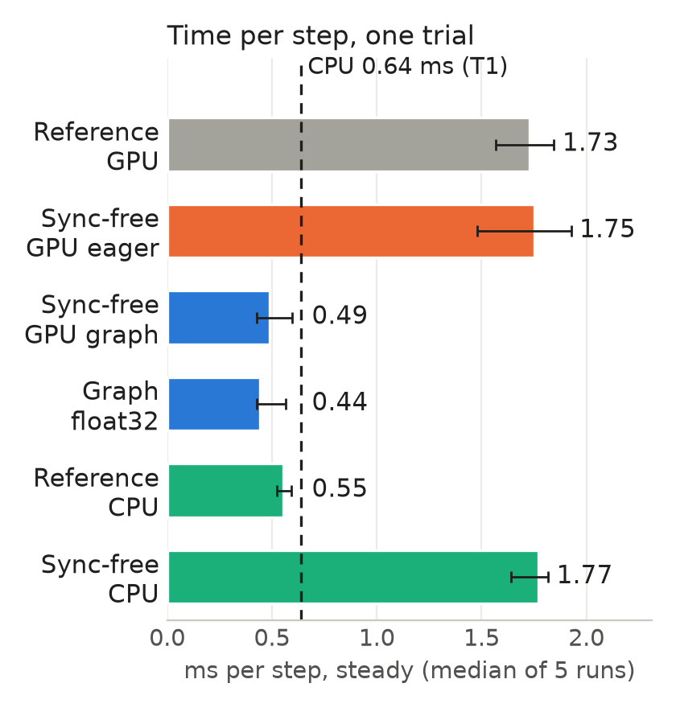

# Week 4 Day 6 part 2 (perf T5b): CUDA graph and GPU timing of the sync-free step

Brief: [progress/week4/tasks/T5b_brief.md](../progress/week4/tasks/T5b_brief.md).
Code: `bench/w4_caps.py` (caps from the reference's looming burst), `bench/w4_graph.py` (graph
replay `graph_trial`, timing rows, sync check, parity; `--runs 5`, JSON + MD),
`bench/w4_graph_plot.py` (bar chart PNG and the HTML table the site embeds),
`tests/test_fast_cuda.py` (GPU tests, skipped on CI). `sim/` is not changed (no change to
`sim/lif_torch_fast.py` was needed for capture).
Results: `perf/results/w4/DESKTOP-4C13T5V_20261122-1021_caps.json`,
`perf/results/w4/DESKTOP-4C13T5V_20261122-1053_graph.{json,md}`, `..._graph_bars.png`,
`..._graph_table.html`.

Setup: RTX 5060 Ti (sm_120), driver 610.88, WSL 3.0.5.0, torch 2.11.0+cu128, 6 CPU threads,
`cns_bundle_calib.npz` (165,122 neurons, 24.5 M synapses), looming, gap + APL + presyn,
`rng='torch'`, seed 0, float64 unless marked. Each row, each run: one trial of 3,000 steps from
t = 0; steps 1,000-2,999 are measured. The suite ran 5 times in one invocation: every value is the
median across runs [min-max across runs].

## Answer

**Yes: replayed as a CUDA graph, one trial on the GPU beats the CPU's 0.64 ms per step.** The
graph step takes 0.49 [0.43-0.60] ms steady and 0.45 [0.42-0.63] ms over all steps, under 0.64 ms
in every run. Against the CPU reference measured in the same session, 0.55 [0.52-0.59] ms, the
graph is faster at the median (about 1.1-1.2x), but the ranges overlap. Without the graph, the
sync-free step is no faster than the reference on the GPU (1.75 vs 1.73 ms).

## Results

| row | steady ms/step | all steps ms/step | stall steps | peak GPU MB |
|---|---|---|---|---|
| Reference, GPU | 1.73 [1.57-1.85] | 1.79 [1.74-1.98] | 2.9% [0.0-26.1%] | 404 |
| Sync-free, GPU eager | 1.75 [1.48-1.93] | 1.84 [1.27-1.93] | 0.4% [0.0-1.1%] | 406 |
| **Sync-free, GPU graph** | **0.49 [0.43-0.60]** | **0.45 [0.42-0.63]** | 0.0% | 414 |
| Sync-free, GPU graph, float32 | 0.44 [0.43-0.56] | 0.44 [0.43-0.45] | 0.0% | 311 |
| Sync-free, GPU eager, float32 | 1.61 [1.21-1.89] | 1.82 [1.32-2.02] | 0.6% [0.0-7.5%] | 303 |
| Sync-free, GPU eager, default caps (200 steps) | - | 7.69 [7.23-7.72] | all > 5 ms | 572 |
| Sync-free, GPU graph, deterministic (200 steps) | - | 8.96 [8.61-9.12] | all > 5 ms | 416 |
| Reference, CPU | 0.55 [0.52-0.59] | 0.55 [0.52-0.59] | 0.0% | - |
| Sync-free, CPU | 1.77 [1.64-1.82] | 1.77 [1.64-1.82] | 0.0% | - |

(The float32 deterministic row is in the JSON/MD: 8.75 [8.57-9.21] ms.)

Timing method:
- **All steps** = synchronized host wall time of the 2,000-step window / 2,000, stalls included,
  from a trial without any per-step instrumentation (GPU rows; CPU rows use the timed trial).
- **Steady** = mean of the steps <= 5 ms (the T1/T3 rule), stall share separate. GPU rows: one
  CUDA event at the start of every step, event to event, so the step is timed on the GPU timeline
  also when the host runs ahead (sync-free rows). CPU rows: host `perf_counter`.
- **CUDA event clock**: on this WSL box CUDA event times read 4-6% high against the host clock
  (two events around a 3 s host sleep: 3.11-3.18 s; per-trial event sum / host wall 1.00-1.09).
  The event spans are therefore rescaled per trial to the host wall of the same window. Steady
  and all-steps values come from two different trials, which is why the graph row's steady value
  can be above its all-steps value.
- **Peak GPU MB** = `max_memory_allocated` over setup + trial, minus what was allocated before
  the row. W alone is ~390 MB on the GPU (int64 indices + float64 data), so most of every row is
  the matrix.

## Caps (step 1)

`bench/w4_caps.py`: the reference, looming, `rng='torch'`, float64, one full trial
(`P['t_run']` = 1 s = 10,000 steps) per seed. A step's spikes are gathered together `dly` steps
later, so the largest gather is the maximum over steps of the summed out-degrees of that step's
spikes.

| seed | spikes | max spikes/step | max W synapses/step | max Wp synapses/step |
|---|---|---|---|---|
| 0 | 186,882 | 40 | 27,517 | 2,451 |
| 1 | 185,731 | 39 | 26,021 | 1,920 |
| 2 | 187,225 | 40 | 29,655 | 1,386 |

Caps = ceil(max x 1.5): **spike_cap = 60, syn_cap = 44,483** (W). Wp needs 3,677; with one
`syn_cap` for both matrices, `lif_torch_fast` gathers Wp with min(syn_cap, the Wp degree bound for
60 columns). Overflow count at these caps: **0** in every fast-path trial of this report (all timed
trials of the 7 capped rows in 5 runs, the 3 x 6 full parity trials, the sync check).

Default caps (spike_cap 4096, syn_cap = sum of the 4096 largest out-degrees) cost 7.7 ms/step and
+166 MB against 1.84 ms and the base 406 MB at the measured caps: hypothesis (d) held.

## Sync check (step 2)

`bench/w4_graph.py` (and `tests/test_fast_cuda.py`): 1,000 eager steps, then 200 steady steps of
the fast path under `torch.cuda.set_sync_debug_mode('error')`, rng='torch'. **Nothing raised.**
Positive control: the reference raises "called a synchronizing CUDA operation" under the same mode
in its first steps. Graph capture is a second, stronger check: a CPU-GPU sync while the stream is
capturing is an error, and the captured step contains every op of a steady step, including the
`torch.where(..., 0.0)` scalars, the index assignments and `nonzero_static`. Capture worked, so
no sync had to be fixed and `sim/lif_torch_fast.py` is unchanged. Caveat from PyTorch itself:
the sync debug mode is a prototype that "does not yet detect all synchronizing operations".
Not covered: `rng='numpy'` (parity mode) still draws on the host and uploads every step, by design.

Ops per steady step of the fast path (TorchDispatchMode, T1's classification): 173 aten ops, of
which 150 launch GPU work. T1 counted ~117 and ~106 for the reference.

## Graph (step 3)

`graph_trial(s)` in `bench/w4_graph.py` runs a prepared `lif_torch_fast._Sim`:
1. 3 real steps of the trial run eagerly on a side stream (the docs' warm-up; they are trial
   steps, not extra ones).
2. For each active-drive combination (the only host-side branch in `step()`), the first time it
   occurs, `_Sim.step(t)` is captured once with `torch.cuda.graph`. All tensors are preallocated
   and the step counter `t_dev` is a device tensor incremented inside the graph, so the same
   graph is valid for every step. The looming trial has one drive that is always on: 1 graph.
   The synthetic tests cover 2 and 3 graphs (drive switched off; overlapping blocks).
3. The graph is replayed once per step.

RNG: the simulator's own `torch.Generator` is registered with each graph
(`CUDAGraph.register_generator_state(s.t_gen)`). Without it, capture fails with "Attempt to
increase offset for a CUDA generator not in capture mode". Docs: PyTorch notes "CUDA semantics",
CUDA Graphs > Constraints (https://docs.pytorch.org/docs/stable/notes/cuda.html#capture-constraints):
CUDA RNG ops are permitted in a graph, also with several `torch.Generator` instances, and
`Generator.get_state`/`set_state` must not be used during capture (the graph-safe variants
instead; this code uses neither). The docs page does not describe `register_generator_state`
(in torch 2.11 its docstring is only the signature). That it is needed and sufficient is shown
here by the capture error without it and by graph == eager counts with it.

## Parity (step 5)

Full trials (10,000 steps), seeds 0-2, GPU:

| check | seed 0 | seed 1 | seed 2 |
|---|---|---|---|
| fast graph vs fast eager, float64: neurons differing | 0 | 0 | 0 |
| fast eager vs reference, float64: rate correlation (active neurons) | 1.000000 (3,865) | 1.000000 (3,887) | 1.000000 (3,870) |
| fast eager vs reference, float64: neurons differing | 0 | 0 | 0 |
| reference vs reference: neurons differing | 0 | 0 | 0 |
| fast graph vs fast eager, float32: neurons differing | 481 | 2,866 | 0 |
| same, float32 with deterministic algorithms | 0 | 0 | 0 |
| fast float32 vs reference float64: rate correlation | 0.9914 | 0.9989 | 0.9993 |

Also: graph vs eager on the timed 3,000-step trials, 0 neurons differing in all 5 runs, float64
and float32.

Float64: identical counts everywhere. The states are not bit-identical, though: between two eager
runs, `v` differs by up to 1.7e-16 after 2,000 steps (graph runs the same). The cause is the
float atomics in `index_add_` on CUDA, whose summation order varies from run to run, in eager and
graph mode alike. In these trials the differences never flipped a spike, so count identity in
float64 is observed, not guaranteed. Float32: the same atomics change counts. Two eager runs of the
same 3,000-step trial already differ in some runs ("same counts both trials" is False for the
float32 eager row), and full float32 trials differ between graph and eager in 2 of 3 seeds. With
`torch.use_deterministic_algorithms(True)`, float32 graph == eager in all 3 seeds, but the step
costs ~9 ms. This is not a graph bug, so the stop condition (graph and eager counts differ) does
not apply to the required float64 rows. Float32 is not reproducible run to run at all.

## Hypotheses

- (a) **Held.** No sync in 200 steady steps under `set_sync_debug_mode('error')`, positive control
  raises, and capture (which forbids syncs) works.
- (b) **Half held.** Launch-bound: yes, 150 GPU ops per step, about 44 more than the reference.
  Faster than the reference: **no**, 1.75 [1.48-1.93] vs 1.73 [1.57-1.85] ms steady. Removing the
  10 syncs (~0.5 ms in T1's budget) is used up by the extra fixed-size kernels.
- (c) **Held.** 0.49 [0.43-0.60] ms steady, 0.45 [0.42-0.63] ms all steps, below the CPU's 0.64 ms
  in every run.
- (d) **Held.** Caps 60 / 44,483: overflow 0; against the default caps, 4x less time per eager step
  and 166 MB less memory.

## Conclusions and Week 5 targets

1. **The graph is what makes the GPU win.** Removing the syncs alone did nothing for a single
   trial (1.75 vs 1.73 ms). Capturing the sync-free step as one graph cut it 3.6x, to
   0.45-0.49 ms, under the CPU's 0.55-0.64 ms. The win over the CPU is small (1.1-1.4x), so a
   single trial does not by itself justify the GPU.
2. **Now the GPU work is the floor (inferred).** Per-step event spans match the synchronized wall,
   and the host enqueues replays faster than the GPU finishes them. That suggests ~0.45 ms is
   the GPU's own time for ~150 small kernels (~3 us each), not launch overhead. Not measured per
   kernel: nsys cannot record CUDA activity under this WSL driver (T3). **Week 5 fusion target:**
   fewer, fused kernels for the gather/scatter (searchsorted + gather + index_add_ for W and Wp)
   and the decay/threshold/reset chain. Aim: <= 0.25 ms per step for one trial.
3. **Batching is the bigger lever.** One trial of 165k neurons and ~19 spikes per step leaves
   most of the GPU idle per kernel. **Week 5 batching target:** B trials per step (state
   (B, n), one graph). Aim: 8 trials at < 1 ms per step, i.e. > 5x the CPU's trial throughput.
   It needs per-trial caps, an overflow flag and RNG streams.
4. **Float32 is not worth it for now.** 0.44 vs 0.49 ms, and counts are no longer reproducible
   run to run (float atomics). Deterministic algorithms fix that at ~9 ms/step. Stay with
   float64. If float32 is needed in Week 5, the scatter must be deterministic and cheap (e.g.
   sorted segment sums).
5. **On the CPU, keep the reference.** The sync-free step is 3.2x slower there (1.77 vs 0.55 ms),
   because it does fixed-size work. CPU runs should keep using `sim/lif_torch.py`.

## Variability

More than 2x across runs:
- all-steps ms/step of the trials *with* per-step events: reference GPU 1.68-3.94 (2.34x) and
  fast eager float32 1.23-2.84 (2.31x), both from WSL stall steps (the reported all-steps
  column, from the trials without events, stays within 1.53x);
- stall share: reference GPU 0.0-26.1% (the WSL stalls of T1/T3), fast eager float32 0.0-7.5%,
  fast eager float64 0.0-1.1%.

No steady value varied more than 1.56x (fast eager float32). The graph rows had no stall step
(> 5 ms) in any run; their all-steps values vary 1.49x (float64, one run at 0.63 ms). CUDA
event clock against the host clock: 1.00-1.09. Bench artifact: the GPU memory still allocated
when a row starts grows by ~65 MB per run within one invocation (8 MB in run 1 to 268 MB in run
5; cause not found). Peak memory is reported relative to it and is constant across runs.

## Gaps in the criteria

- "Graph vs eager counts identical" holds for float64 in every check here, but it is not
  guaranteed: float atomics make the state differ bitwise run to run. For float32 it does not
  hold, in eager vs eager either.
- QA's "median inside Dev's min-max widened by 25%" is undefined for stall shares with min 0 and
  for the rows without a steady value (default caps, deterministic). For those, use the
  all-steps column.
- The CPU baseline of the brief (0.64 ms, T1) and the one measured here (0.55 ms) differ by 15%.
  The graph beats both at the median.
