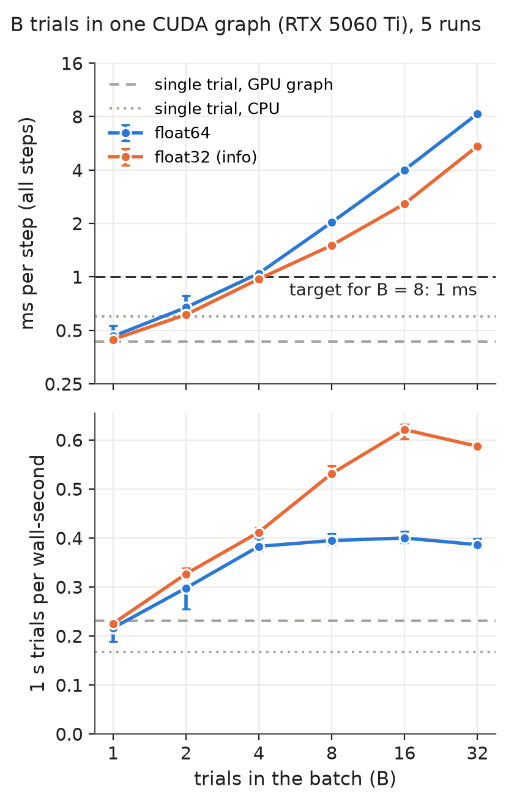

# Week 5 P1 (perf): B trials in one CUDA graph, float64 reference

Brief: [progress/week5/tasks/P1_brief.md](../progress/week5/tasks/P1_brief.md). Branch `perf/w5-p1-batched`.
PC: RTX 5060 Ti 16 GB (sm_120), driver 610.88, WSL 3.0.5.0, torch 2.11.0+cu128, 6 CPU threads.
Raw results: [perf/results/w5/DESKTOP-4C13T5V_20261125-1020_batch.json](results/w5/DESKTOP-4C13T5V_20261125-1020_batch.json)
(+ `.md`, `.log`, `_scaling.png`, `_table.html`), and
[DESKTOP-4C13T5V_20261125-1046_realizations.json](results/w5/DESKTOP-4C13T5V_20261125-1046_realizations.json).

## Summary

- `sim/lif_torch_batch.run_batch` runs B independent trials (own seed, own `blocks`, own caps and overflow
  flag) over one shared network, state (B, n), one CUDA graph replay per step for the whole batch. Each
  batched trial is spike-for-spike equal to running it alone: exact on the CPU (A1), B = 1 vs B = 8 identical
  on the GPU (A2), and identical to the GPU reference (A3: correlation 1.0, 0 neurons differ, 8 seeds).
- **B = 8 does not run under 1 ms per step: 2.04 [1.97-2.09] ms steady, float64.** That is above the brief's
  2 ms stop line (median; the minimum run is 1.97), so the **stop condition is hit**: the op count and the
  phases that grew are reported below, and nothing was tuned after the first working version.
- **Trials per wall-second stop growing at B = 8**: 0.216 (B = 1), 0.297, 0.383, **0.395 (B = 8), 0.400 (B = 16)**,
  0.386 (B = 32), one-second trials, float64. B = 8 gives 1.7x the single-trial GPU graph (0.231) and 2.4x the
  PC CPU single trial (0.168) measured in the same session. Float32 (information): 0.531 at B = 8, 0.621 at B = 16.
- Why it flattens: the kernel count barely grows (173 -> 180 -> 204 GPU ops per step at B = 1 / 8 / 32: one RNG
  draw per trial), but the work per op does. Per-phase GPU time: the padded gathers (synaptic, presyn,
  spikelets) grow linearly with B because every trial reads its full cap of entries every step, and the
  decay grows faster than B from B = 8 on (0.33 -> 1.22 -> 3.04 ms at B = 8 / 16 / 32), consistent with the
  (B, n) state no longer fitting the 32 MB L2.

## Scaling table (float64 reference, 5 runs, median [min-max])

Looming bundle (n = 165,122, gap + APL + presyn), rng='torch', seeds 0..B-1, 2,000 steps after 1,000 warm-up
steps (Day 6 method), caps per trial `spike_cap = 60`, `syn_cap = 44,483` (Wp 3,677). trials/s = one-second
trials (10,000 steps) per wall-second from the all-steps ms/step; bio-s per wall-s is the same number
(1 trial = 1 bio-s). Sim-busy check before and after every row (14 rows x 5 runs x 2 = 140 checks, plus one before the phase timing): nothing running in any.

| row | B | steady ms/step | stall share | all-steps ms/step | trials/s | peak GPU MB | overflow |
|---|---|---|---|---|---|---|---|
| batch graph f64 | 1 | 0.474 [0.443-0.531] | 0 [0-0] | 0.463 [0.448-0.530] | 0.216 [0.189-0.224] | 405 | 0 |
| batch graph f64 | 2 | 0.690 [0.672-0.786] | 0 [0-0] | 0.672 [0.655-0.785] | 0.297 [0.255-0.305] | 419 | 0 |
| batch graph f64 | 4 | 1.064 [1.019-1.119] | 0 [0-0] | 1.045 [1.000-1.071] | 0.383 [0.374-0.400] | 447 | 0 |
| **batch graph f64** | **8** | **2.038 [1.967-2.090]** | 0 [0-0] | 2.027 [1.958-2.073] | **0.395 [0.386-0.409]** | 504 | 0 |
| batch graph f64 | 16 | 3.994 [3.940-4.086] | 0 [0-0] | 4.002 [3.870-4.105] | 0.400 [0.390-0.413] | 613 | 0 |
| batch graph f64 | 32 | - (every step > 5 ms) | 1 [1-1] | 8.285 [8.028-8.379] | 0.386 [0.382-0.399] | 832 | 0 |
| fast graph f64 (Week 4 path) | 1 | 0.438 [0.425-0.458] | 0 [0-0] | 0.432 [0.423-0.548] | 0.231 [0.182-0.236] | 406 | 0 |
| reference, PC CPU f64 | 1 | 0.596 [0.565-0.632] | 0 [0-0.0005] | 0.596 [0.565-0.635] | 0.168 [0.158-0.177] | - | - |
| batch graph f32 (info) | 1 | 0.448 [0.426-0.577] | 0 [0-0] | 0.444 [0.433-0.469] | 0.225 [0.213-0.231] | 302 | 0 |
| batch graph f32 (info) | 2 | 0.620 [0.603-0.668] | 0 [0-0.0005] | 0.613 [0.591-0.618] | 0.327 [0.324-0.339] | 311 | 0 |
| batch graph f32 (info) | 4 | 0.976 [0.952-1.038] | 0 [0-0] | 0.972 [0.951-0.982] | 0.411 [0.407-0.421] | 332 | 0 |
| batch graph f32 (info) | 8 | 1.497 [1.463-1.527] | 0 [0-0] | 1.506 [1.462-1.520] | 0.531 [0.526-0.547] | 368 | 0 |
| batch graph f32 (info) | 16 | 2.525 [2.497-2.651] | 0 [0-0] | 2.577 [2.530-2.660] | 0.621 [0.602-0.632] | 439 | 0 |
| batch graph f32 (info) | 32 | - (every step > 5 ms) | 1 [1-1] | 5.453 [5.385-5.490] | 0.587 [0.583-0.594] | 583 | 0 |

B = 32: the Day 6 stall rule (a step > 5 ms is a stall) makes every step a "stall", so there is no steady
mean; the median of all window steps (no threshold) is 8.272 [8.268-8.580] ms (float64), 5.404 [5.257-5.486]
ms (float32), close to the all-steps numbers. Peak GPU memory is above the memory allocated before the row
and includes the 24.5 M-entry W on the device (~390 MB). Float32 counts differ between the two trials of
a row in every run (float atomics, as in Week 4); float64 counts were identical in every row and run.

**Clock.** CUDA events at every window step, rescaled so that the spans sum to the synchronized host wall of
the same window (Day 6 method). The event clock read 1.05-1.07x the host clock in every row (recorded per row
as `event_over_host_clock`). The rescale keeps steady ms/step and all-steps ms/step on one clock and comparable
with the Week 4 Day 6 numbers (fast graph 0.49 ms then, 0.44 here). The phase table below uses raw events
(gated method, no host wall to rescale against).

## Where trials/s stops growing and why

Trials/s grows 1.8x from B = 1 to B = 4, then by 3% to B = 8, 1% to B = 16 (ranges overlap) and falls at
B = 32. From B = 4 on, ms/step roughly doubles with B (1.06 -> 2.04 -> 3.99 -> 8.27 ms).

Evidence:

1. **GPU ops per step** (eager step, TorchDispatchMode, ops with a CUDA output), JSON `ops_per_step`:
   173 / 174 / 176 / 180 / 188 / 204 at B = 1 / 2 / 4 / 8 / 16 / 32. The only ops that scale with B are the
   per-trial RNG draws (one `uniform_` per drawing trial). So launches are not what grows.
2. **GPU time per phase per step** (eager, gated: `torch.cuda._sleep(1 ms)` before every phase so the host
   enqueues the phase while the GPU sleeps; raw events; median of 30 steady steps), JSON `phases`, ms:

| phase | B = 1 | 2 | 4 | 8 | 16 | 32 | what it touches per trial |
|---|---|---|---|---|---|---|---|
| decay | 0.086 | 0.106 | 0.150 | 0.335 | 1.222 | 3.040 | (B, n) v, g, last, rfc_n |
| gap (2b) | 0.064 | 0.055 | 0.069 | 0.095 | 0.145 | 0.249 | dense 830 x 830 matmul per trial |
| threshold + spike lists | 0.207 | 0.214 | 0.255 | 0.272 | 0.364 | 0.714 | (B, n) mask, nonzero_static over B x n |
| presyn | 0.235 | 0.301 | 0.407 | 0.553 | 0.623 | 0.900 | Wp gather, 3,677 entries per trial |
| synaptic | 0.221 | 0.253 | 0.345 | 0.488 | 0.909 | 1.812 | W gather, 44,483 entries per trial |
| drive | 0.072 | 0.087 | 0.108 | 0.136 | 0.163 | 0.273 | 311 entries per trial + B draws |
| spikelets | 0.242 | 0.275 | 0.385 | 0.512 | 0.533 | 0.854 | gap gather, 49,884 entries per trial |
| apl | 0.066 | 0.073 | 0.081 | 0.081 | 0.079 | 0.090 | 4,064 KCs |
| reset + record + ring | 0.103 | 0.102 | 0.144 | 0.241 | 0.530 | 1.044 | (B, n) where/copy, counts |
| **sum** | 1.258 | 1.475 | 1.978 | 2.693 | 4.567 | 8.980 | |

   The gated sum overstates the graph's step (2.69 vs 2.04 ms at B = 8): each phase starts on a GPU that just
   slept, and per-op launch latency inside the phase is counted. The table is used for which phases grow.
   - **Decay** grows 2.2x from B = 4 to 8, 3.6x from 8 to 16 and 2.5x from 16 to 32. Week 4 Day 5: one
     trial's decay state is 5.3 MB and fits the 32 MB L2; 8 trials (42 MB) do not. The jump above
     linear starts where the state outgrows L2 (B = 8-16); after that it is DRAM-bound.
   - **The three padded gathers** (synaptic + presyn + spikelets) are 0.70 ms at B = 1, 1.55 at B = 8,
     3.57 at B = 32. Each trial reads its whole cap every step (44,483 + 3,677 + 49,884 = 98,044 entries),
     whatever its spike count (~19 spikes per step on looming). The spikelet gather uses the full gap nnz
     as its cap (inherited from T5a, where it cannot overflow), which is 13x the synaptic entries a
     looming step needs.
   - **Elementwise (B, n) work** (threshold, reset/record/ring) grows ~linearly from B = 4.
3. **Stop condition (brief: B = 8 above 2 ms after the first working version).** Steady 2.038 [1.967-2.090]
   ms. From B = 1 to B = 8 the gated phases grew by +1.44 ms: gathers +0.86 (presyn +0.32, synaptic +0.27,
   spikelets +0.27), decay +0.25, reset/record/ring +0.14, threshold +0.07, drive +0.06, gap +0.03. Op count
   +7. Not tuned further. Obvious next steps for the Lead to brief (not done here): a spikelet cap from the
   measured burst instead of the full gap nnz, and the fused decay/threshold and gather kernels of Week 5
   target 2 (which Charlie writes).

## Hypotheses

| | hypothesis | verdict | evidence |
|---|---|---|---|
| (a) | per-step time grows far slower than B (launch-bound): B = 8 < 1 ms | **does not hold** | B = 8 2.04 ms steady; ms/step ~doubles per doubling of B from B = 4; launch count +7 ops from B = 1 to 8, the growth is per-op work (phase table). Launch-bound only up to B = 2-4. |
| (b) | trials/s keeps growing to at least B = 16 | **does not hold** | 0.395 at B = 8, 0.400 at B = 16 (ranges overlap), 0.386 at B = 32 (float64). Float32: grows to B = 16 (0.621), falls at 32. |
| (c) | batched gather over per-trial padded lists keeps each trial's float64 counts identical to its solo run | **holds (observed)** | A1 exact on CPU (counts, t/i, final v/g bitwise); A2 0 neurons differ B = 1 vs B = 8 at 2 slots for 3 seeds; A3 0 neurons differ vs the GPU reference for 8 seeds. On the GPU this rests on float64 atomics in `index_add_` happening to give identical counts (states may differ in the last bit, as in Week 4); not guaranteed. |
| (d) | per-trial drive windows in device masks indexed by the step counter: one graph serves B trials with different blocks | **partly holds** | Windows are device masks (one replay per step for the batch, A4). But to draw exactly the reference's numbers (needed for A3, see below) a trial must draw only for its active drives, so the graph is keyed by the set of drawing (trial, drive) pairs: 11 graphs for the A4 batch of 8 different blocks lists. With `draws='always'` one graph serves any blocks (A4: 1 graph), at the cost of a different RNG stream than the reference. |

Why reference-identical draws: two Poisson realizations of the same looming trial (reference, different seeds)
correlate 0.986-0.996 on active neurons (`..._realizations.json`), below A3's 0.999. A batch with its own stream
(counter-based, or draws on inactive drives) would be such a different realization, so A3 would fail by
construction. The batch therefore uses one `torch.Generator` per trial seeded with the trial's seed and draws
`Tensor.uniform_(0, 1, generator)` on its slice of one buffer per active drive, in drive order; on this torch
build that equals `torch.rand` bitwise (checked on CPU and CUDA). Each trial's stream depends only on its seed
and blocks, never on B or its slot (A2).

RNG in the graph: all B generators are registered with every captured graph
(`CUDAGraph.register_generator_state`, no limit hit at B = 32; torch 2.11's `CUDAGraph` has no `num_rng_states`
argument). Docs: PyTorch "CUDA semantics" notes, CUDA Graphs > Constraints
(https://docs.pytorch.org/docs/stable/notes/cuda.html): RNG ops are allowed in capture, also with several
`torch.Generator` instances; the docstring of `register_generator_state` in torch 2.11 is only its signature,
so that registration is needed and sufficient is shown by the tests (graph == eager, graph == reference),
as in Week 4 T5b.

## Acceptance criteria

| | criterion | result | evidence |
|---|---|---|---|
| A1 | CPU float64 rng='numpy', B = 3, 3 seeds, 3 blocks lists; options off, all options, overlapping blocks: counts and t/i equal the reference alone | **pass** | `tests/test_batch_cpu.py::test_parity_batch` (also rng='torch'), plus exc drive + t_stim + bins, final v/g bitwise, slot invariance, overflow fallback, zero syncs |
| A2 | GPU float64 rng='torch', bundle, seed s identical in B = 1 and B = 8 at >= 2 slots, full looming trial | **pass** | JSON `parity.A2`: seeds 0, 3, 7 at slots 0/7, 3/4, 7/0, 0 neurons differ; B = 8 forward vs reversed: 0 differ for all 8 seeds; overflow 0 |
| A3 | batched B = 8 vs GPU reference, same seeds: rate corr >= 0.999 per trial; share differing reported | **pass** | JSON `parity.A3`: corr 1.0, 0 neurons differ (share 0.0) for seeds 0-7, 1 s trials |
| A4 | one graph replay per step for the whole batch with different blocks; sync debug 'error' raises nothing over 200 steady steps (+ positive control); overflow 0 in every timed trial | **pass** | JSON `a4`: 8 trials with 8 different blocks lists (looming / vinegar / sugar, windows, overlaps): 9,997 replays for 9,997 graph steps (11 graphs, draws='active'; 1 graph, draws='always'); sync 'error' over 200 steady steps of the eager batch and of the graph replays: nothing raised; reference raises; overflow 0 in every timed trial (`overflow_total` 0 in all rows) |
| A5 | scaling table B = 1..32, medians + min-max, sim-busy check per run, plain statement on B = 8 and where trials/s stops | **pass** | table above; `busy_check_before` / `busy_check_after` per row and run in the JSON (all False). B = 8 is **not** under 1 ms/step (2.04 ms). trials/s stops growing at B = 8. |
| A6 | `pytest -q tests/` green on the PC with CUDA (count) and CI cpu-tests green; `git diff --stat main...HEAD -- sim/` only `sim/lif_torch_batch.py`; `tests/test_fast_*.py` green | **pass on the PC**; CI on the PR | PC (WSL venv, CUDA): 86 passed (incl. `test_fast_*.py`); `CUDA_VISIBLE_DEVICES=""`: 78 passed, 8 skipped. `git diff --stat main...HEAD -- sim/`: only `sim/lif_torch_batch.py` (`lif_torch_fast.py` helpers imported, not moved). CI cpu-tests: see the PR checks |

## Caps

Per trial, as Week 4 T5b (`bench/w4_caps.py`, 1.5x the max over 3 seeds): `spike_cap = 60`, `syn_cap = 44,483`,
Wp cap min(syn_cap, degree bound) = 3,677, gap spikelet cap = gap nnz 49,884. Overflow 0 in every timed trial
(seeds 0-31) and in A2-A4. A trial that exceeds a cap is rerun alone with `lif_torch.run_trial`; a trial placed
after an overflowing one in the batch can lose spikes from the flattened spike list and is then rerun too
(only possible when some trial overflowed; `tests/test_batch_cpu.py::test_overflow_reruns_only_that_trial`).

## Estimate: one `w5_hidden_state.py` chunk batched (estimate, not run)

Today (`progress/week5/hidden_state_dataset.md`): calib 120 episodes x 4 s = 480 bio-s in 3.26 h (24.5 s per
bio-s), CPU float32 rng='torch', one process, same W (24,519,583 nnz) as the bundle. Batched on the 5060 Ti in
float32 at B = 8: 0.531 bio-s per wall-s (looming bundle) -> 480 bio-s in ~15 min (~0.25 h; B = 16: ~13 min),
float64 B = 8: ~20 min. That is ~13x the logged CPU loop, or ~3x against the PC CPU single trial measured here
(0.168 bio-s/wall-s, float64, looming, no recording), so the logged 24.5 s/bio-s is itself ~4x slower than this
bench's CPU row (recording, blocks, float32, or another machine: not checked). Not measured for the science
workload: graph captures per batch (words episodes change their drawing set at every block boundary of any
trial; or use draws='always'), recording cost, and the caps (spike_cap 60 was measured on looming only;
150 Hz words drives may overflow and fall back to the reference).

## Built / assumed / unverified

**Built:** `sim/lif_torch_batch.py` (`run_batch`, `_prepare`, `eager_loop`, `graph_loop`); `bench/w5_batch.py`,
`bench/w5_batch_plot.py`, `bench/w5_realizations.py`; `tests/test_batch_cpu.py` (16 tests), `tests/test_batch_cuda.py`
(5, skipped without CUDA). No change to `sim/lif_torch.py` or `sim/lif_torch_fast.py`.

**Assumed:** the Week 4 caps hold for seeds 0-31 (observed: overflow 0); gated phase times rank the phases
correctly although their sum overstates the graph step; the L2 explanation of the decay jump (consistent with
Week 4's byte counts, no L2 counter read).

**Unverified:** count identity on the GPU is observed, not guaranteed (float atomics); the bmm-expand gap matmul
equalling `torch.mv` bitwise is observed for B = 1-32 on this GPU only; the hidden-state estimate; capture
cost and memory with many graphs (shared pool, tested with up to 11 graphs).

## Gaps in the acceptance criteria (flagged, not changed)

- A3's 0.999 can only be met with the reference's own draws (independent realizations: 0.986-0.996), which ties
  the graph to the active drive set (hypothesis d). The brief's counter-based Philox guidance would fail A3.
- The Day 6 stall rule (> 5 ms) leaves B = 32 without a steady number; the median of all steps is given instead.
- "Where trials/s stops growing": B = 8 and B = 16 overlap within their min-max; stated as flat from B = 8.
- The stop line "B = 8 above 2 ms" is met by the median (2.038) but not by the fastest run (1.967).
